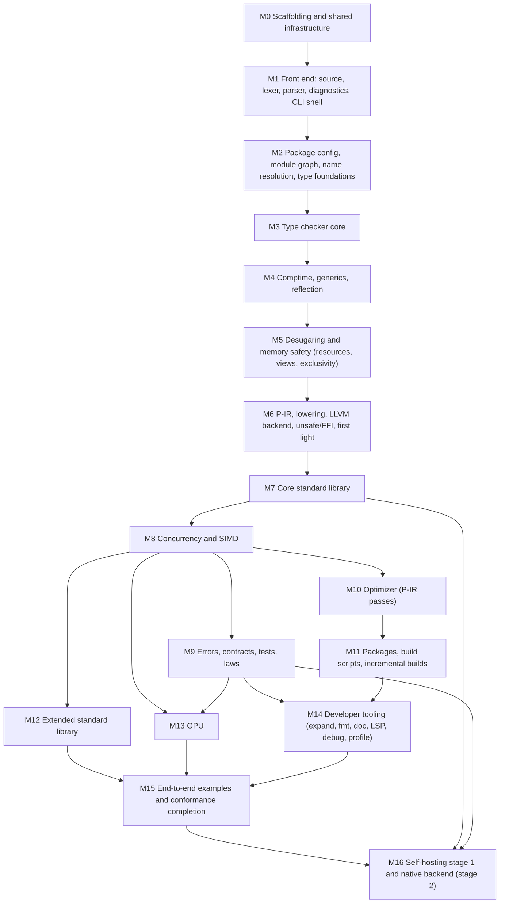

# Pyro implementation tasks

Master plan for the stage-0 compiler (Zig, `spec/B-compiler-architecture.md` B.6.1), runtime, standard library, tooling, GPU stack, and the stage-1 self-hosted compiler. Spec: `spec/`.

## Legend

- `- [ ]` / `- [x]`: task open / done.
- **[CRITICAL]**: on the longest weighted dependency chain (to first light, to stage-0 completion, or to the final task). Delays here delay the project.
- **[GATE]**: chokepoint many tasks wait on (frozen shared contract or >= 6 direct dependents). Land, review and freeze these first.
- **Size**: S (<= 2 days), M (<= 1 week), L (<= 3 weeks), XL (> 3 weeks; split further when started).
- **Blocked by**: tasks that must be merged first. **Blocks**: tasks waiting on this one.
- **Parallel**: wave tag `Wnn`. All tasks with the same tag have every blocker in earlier waves, so they can run concurrently. **Conflicts** names shared files that need a single owner or serialized edits.

## Using this with ultracode

1. One wave = one workflow fan-out. Start one agent per task in the wave, each in its own git worktree on its own branch.
2. Each agent owns only the files named in its Deliverable. Shared files listed under Conflicts: append-only edits, or route through the owning task.
3. A task is done when its Acceptance tests pass in `zig build test` / `zig build conformance`. Tick its box.
4. Merge every finished task of the wave into `main`, run CI, then start the next wave. A task may start early if all its Blocked-by tasks are already merged; waves are the safe default.
5. GATE tasks freeze an interface (TokenKind, AST NodeKind, TIR opcodes, DiagCode, P-IR opcodes, attribute and builtin tables, memo table). Changes after merge go through the owning task's file only.
6. Conformance-case tasks (`conformance/NN-*`) are test-first: they need only the harness and the spec, and run early in parallel with implementation.
7. Dependencies live only in each task's `Blocked by:` and `Size:` lines. After changing them or adding a task, run `python3 tools/plan/tasks.py regen` to rebuild Blocks, wave tags, the Waves table, critical paths and fan-out GATE tags; `python3 tools/plan/tasks.py check` validates the DAG and same-wave file overlap.

## Waves

| Wave | Tasks (run concurrently) |
|---|---|
| W00 | T001 |
| W01 | T002, T003, T004, T005, T006, T007, T008, T009, T010 |
| W02 | T011, T012, T013, T014, T015, T016, T029, T084, T085, T086, T104, T119, T120, T134, T157, T174, T175, T216 |
| W03 | T017, T018, T030, T031, T032, T087, T121, T122, T146, T158 |
| W04 | T019, T033, T034, T035, T088, T159 |
| W05 | T020, T021, T022, T160 |
| W06 | T023, T024, T036 |
| W07 | T025, T037, T161 |
| W08 | T026, T038 |
| W09 | T027, T028, T039, T210 |
| W10 | T040 |
| W11 | T041, T042, T043, T044 |
| W12 | T045, T046, T047, T048, T049, T056 |
| W13 | T050, T051, T052, T053, T054, T057 |
| W14 | T055, T058 |
| W15 | T059, T060 |
| W16 | T061, T062, T063 |
| W17 | T064, T065, T066, T067, T076, T077, T176 |
| W18 | T068, T069, T078, T177, T178, T179 |
| W19 | T070, T071, T072, T073, T079, T089, T180 |
| W20 | T074, T075, T080, T081, T090, T091, T181 |
| W21 | T082, T092, T093, T094, T123, T124, T135, T182 |
| W22 | T083, T095, T096, T097, T098, T136, T137, T162, T163, T183, T184, T185, T186, T211, T212 |
| W23 | T099, T105, T125, T126, T138, T139, T147, T164, T165, T187, T188, T189, T190, T191, T192, T193, T213 |
| W24 | T100, T101, T102, T103, T106, T107, T108, T127, T128, T129, T148, T194, T195, T196, T197, T198, T214, T245 |
| W25 | T109, T110, T111, T112, T130, T131, T149, T150, T151, T152, T169, T199, T200, T201, T215 |
| W26 | T113, T114, T115, T116, T132, T140, T153, T202, T203, T204, T205, T217 |
| W27 | T117, T118, T133, T141, T142, T143, T154, T155, T166, T167, T170, T171, T172, T206, T207, T208, T218, T219, T220, T229, T230, T231, T232, T233, T234, T235, T236 |
| W28 | T144, T156, T168, T173, T221, T224, T242 |
| W29 | T145, T225 |
| W30 | T209, T222 |
| W31 | T223 |
| W32 | T226 |
| W33 | T227, T228 |
| W34 | T237, T238, T239, T240, T241 |
| W35 | T243 |
| W36 | T244 |

## Critical paths

Weights: S=2, M=5, L=15, XL=30 days. **[CRITICAL]** = zero slack on one of these chains.

- To first light (first end-to-end run): T001 -> T003 -> T011 -> T018 -> T019 -> T021 -> T023 -> T025 -> T039 -> T040 -> T043 -> T057 -> T058 -> T060 -> T063 -> T077 -> T078 -> T089 -> T091 -> T093 -> T095
- To stage-0 completion: T001 -> T003 -> T011 -> T018 -> T019 -> T021 -> T023 -> T025 -> T039 -> T040 -> T043 -> T057 -> T058 -> T060 -> T063 -> T077 -> T078 -> T089 -> T091 -> T093 -> T095 -> T105 -> T106 -> T110 -> T113 -> T142 -> T144 -> T145 -> T209 -> T223
- Overall (ends at T244): T001 -> T003 -> T011 -> T018 -> T019 -> T021 -> T023 -> T025 -> T039 -> T040 -> T043 -> T057 -> T058 -> T060 -> T063 -> T077 -> T078 -> T089 -> T091 -> T093 -> T095 -> T105 -> T106 -> T110 -> T113 -> T117 -> T224 -> T225 -> T226 -> T228 -> T237 -> T243 -> T244

## Milestone dependency graph

## Spec issues to resolve (do not invent codes)

- §11 says SPIR-V 1.6, B.8 says SPIR-V 1.5. Plan uses 1.6 (normative chapter).
- No diagnostic code for a trap during comptime evaluation (bounds, overflow). Plan reports the trap kind + comptime trace; needs a spec code.
- E0701 says "contract condition"; @ensures needs `result`. Plan applies static checking to @requires and invariants only.
- No code for `@allow(E....)`; plan treats it as no effect.
- Registry wire protocol, archive format, publish auth unspecified (§13.4). Decision recorded in `docs/registry.md`.
- `pyro fmt` style and doc-comment markup unspecified. Decisions recorded in `docs/style.md`.
- §5.3.2 implicit move of resource temporaries vs E0327; E0330 covers several distinct violations (may need sub-kinds).
- §11.6.5 mentions std.gfx with no API: no task until specified.
- Split codes: E0108 (lexer magnitude vs post-negation fit), E0207 and E0211 (syntactic in post-parse checks, semantic in checker), E0212 (checker). Owners listed in tasks.

## Cross-cutting rules

- Deterministic output: diagnostics sorted by (file, offset); layouts and hash maps never depend on iteration order (cache keys, §4.11, B.7).
- Cascade rule (A.1): poisoned nodes from the diagnostics core are honoured by parser, resolver, checker.
- No optimization may change trap behaviour (B.5.3, §13.9); every pass merges only with the difftest harness green. Contracts and laws never feed optimizer facts.
- Comptime determinism (§8.6): target-width ints, soft strict IEEE; test on two hosts.
- Every error code: one passing and one failing case (B.9). Implementation tasks add cases for their codes in the matching `conformance/NN-*` directory (append-only, one file per case, no conflicts).
- LLVM stays behind `-Dllvm=true`; front-end agents need no LLVM install.
- GPU CI: lavapipe/SwiftShader (Vulkan), macOS runners (Metal), wgpu-native/Dawn (WebGPU). Mesh/RT acceptance may skip with reason on CI lacking hardware.

## M0. Scaffolding and shared infrastructure

- [x] **T001** Repo bootstrap: Zig stage-0 skeleton, build steps, CI **[CRITICAL]** **[GATE]**
  - Spec: B.6.1, B.1, B.9
  - Deliverable: `build.zig`, `build.zig.zon` (pinned Zig version); dirs `stage0/src/{base,source,diag,lex,parse,ast,sema,tir,comptime,lower,pir,opt,backend,driver,cli,gpu}`, `runtime/`, `std/`, `conformance/`, `examples/`, `tools/`; steps `zig build`, `zig build test`, `zig build conformance`; `-Dllvm=true` flag (LLVM linkage only behind it); `.github/workflows/ci.yml`; `CONTRIBUTING.md` with per-directory ownership rules.
  - Acceptance: `zig build` yields `pyro` that prints usage and exits 2; `zig build test` green in CI; front-end build needs no LLVM.
  - Size: S · Parallel: W00
  - Blocked by: none
  - Blocks: T002, T003, T004, T005, T006, T007, T008, T009, T010
- [ ] **T002** Shared infra: arenas, u32 index types, job pool, string interner
  - Spec: B.1, B.4
  - Deliverable: `stage0/src/base/`: per-stage/per-thread arenas, typed u32 index wrappers, fixed-size thread pool honouring `--jobs`, thread-safe interner (bytes -> u32).
  - Acceptance: Interner returns equal ids for equal bytes under 8 threads; pool runs and joins N jobs; arena reset O(1).
  - Size: S · Parallel: W01
  - Blocked by: T001
  - Blocks: T018, T022, T032
- [ ] **T003** Diagnostics core: data model, code registry generated from A.3, sink **[CRITICAL]** **[GATE]**
  - Spec: A.1, A.2, A.3, §1.2
  - Deliverable: `stage0/src/diag/`: `Diagnostic{code,severity,message,spans,help,fixes,trace}`; `DiagCode` enum generated at build time from `spec/A-diagnostics.md` tables (incl. W9xxx impl range); thread-safe sink with deterministic order (file, offset); cascade suppression via poisoned node/span ids. API frozen on day 1.
  - Acceptance: Build fails if source uses a code absent from A.3; 4-thread emission prints in stable order; diagnostic caused by poisoned node dropped.
  - Size: M · Parallel: W01
  - Blocked by: T001
  - Blocks: T011, T012, T013, T017, T019, T027, T029
  - Conflicts: Owns the core files in `stage0/src/diag/` and the generated code enum; T017 (renderers) and T027 (levels) add their own files there and never edit core files. `build.zig`: edits only `addCommonImports` (one `diag_codes` import line).
- [ ] **T004** Conformance harness (B.9) and e2e example runner **[GATE]**
  - Spec: B.9, A.2, §1.2, §13.3, Appendix D
  - Deliverable: `tools/conformance/` (Zig, `zig build conformance`): walks `conformance/<NN-chapter>/*.pr`; parses line-anchored `//~ E0332`/`//~ W0201`; runs `pyro check --message-format json` and matches code+line sets exactly; `<case>.out` run-pass cases run in dev/test/prod (identical output unless marked `debug_assertions`); per-directory `stop-after` (lex/parse/check/run); expected-fail tag; path filter; A.3 coverage report (codes lacking a pass and a fail case); also drives `examples/<name>/` packages via `pyro run`/`pyro test` against `expected.out`.
  - Acceptance: Self-tests with a fake compiler cover match, missing, extra, wrong line, env mismatch; coverage report initially lists every A.3 code.
  - Size: M · Parallel: W01
  - Blocked by: T001
  - Blocks: T015, T016, T095, T104, T120, T134, T157, T175, T209, T216
  - Conflicts: `build.zig`: edits only the `zig build conformance` block (harness arguments).
- [ ] **T005** Token kinds and keyword perfect hash
  - Spec: §2.2, §2.4.1-§2.4.3, §2.7, B.2
  - Deliverable: `stage0/src/lex/token.zig`: `TokenKind` u8 enum (all keywords, literal classes, BUILTIN, punctuators incl. `.{`, DOC_COMMENT, EOF, Invalid); SoA `TokenBuffer{kind,start,len}`; build-time perfect hash; future-reserved set; literal sub-scanner signatures (contract for literal lexer).
  - Acceptance: Every §2.4.1 keyword maps to its kind; `gpu`/`cpu`/`over`/`result` stay IDENT; §2.4.2 words flagged future-reserved; hash collision-free (checked at build).
  - Size: S · Parallel: W01
  - Blocked by: T001
  - Blocks: T012, T013, T014
  - Conflicts: TokenKind frozen after merge; later additions go through this file's owner only.
- [ ] **T006** P-IR data structures, types, text format, builder
  - Spec: B.5, B.5.1, B.5.2
  - Deliverable: `stage0/src/pir/{ir,builder,text}.zig`: module/globals (align, readonly), functions with param attrs (noalias, readonly, align, dereferenceable), blocks with block params, every B.5.2 opcode incl. flags; text printer + parser; types i1..i64, f32, f64, ptr, vec<N x T>, void.
  - Acceptance: Parse-print round-trip of hand-written modules covering every opcode group.
  - Size: M · Parallel: W01
  - Blocked by: T001
  - Blocks: T084, T085, T089, T182
  - Conflicts: Owns the P-IR opcode enum; later tasks add opcodes only via this owner.
- [ ] **T007** TOML v1.0 parser and format-preserving serializer
  - Spec: §13.2, §13.4
  - Deliverable: `stage0/src/toml/`: typed tree with byte spans; serializer that round-trips unedited documents byte-identically.
  - Acceptance: Vendored toml-test v1.0 valid/invalid corpus passes; spans map to 1-based line/col; unedited round-trip byte-identical.
  - Size: M · Parallel: W01
  - Blocked by: T001
  - Blocks: T029, T159
- [ ] **T008** SemVer 2.0 and version-requirement library
  - Spec: §13.2, §13.4
  - Deliverable: `stage0/src/pkg/semver.zig`: versions with prerelease/build; requirements `1.2`, `^`, `~`, `=`, ranges (Cargo semantics); compatibility-line key (major, or minor for 0.x).
  - Acceptance: `1.2` == `^1.2` == >=1.2.0 <2.0.0; `~1.2.3`; `>=1.2, <1.5`; 0.x keys on minor; prerelease ordering per SemVer 2.0.
  - Size: S · Parallel: W01
  - Blocked by: T001
  - Blocks: T029, T158
- [ ] **T009** Target triple model and support table
  - Spec: §13.2.1, §14.8, B.6.1
  - Deliverable: `stage0/src/target.zig`: parse `arch-os[-abi]`; §13.2.1 support table; LLVM triple mapping; values for `std.meta.Target` (arch, os, abi, pointer_bits, endian, CPU features, `@vector_width` table).
  - Acceptance: Every §13.2.1 triple parses and maps; unknown triple -> plain diagnostic; host detection on linux x86_64.
  - Size: S · Parallel: W01
  - Blocked by: T001
  - Blocks: T073, T088, T129, T167
- [ ] **T010** Runtime core: trap entry, TrapKind, hosted abort path (Zig)
  - Spec: §9.4, §9.3
  - Deliverable: `runtime/trap.zig`: C-ABI `pyro_rt_trap(kind,msg,file,line)` writing kind/message/location to stderr, exit status 134, no defer execution; `std/core/trap.pr` TrapKind enum declaration (all kinds incl. deadlock, capacity, contract, todo_err, gpu_limit, ray_recursion).
  - Acceptance: Zig test: calling the entry from a C harness prints the §9.4 format and exits 134.
  - Size: S · Parallel: W01
  - Blocked by: T001
  - Blocks: T086, T088, T119, T136, T174
  - Conflicts: `build.zig`: edits only the `runtime` branch of `addTreeOptions` (C harness wiring).

## M1. Front end: source, lexer, parser, diagnostics, CLI shell

- [ ] **T011** Source loading and SourceMap **[CRITICAL]**
  - Spec: §2.1, §2.1.1, §2.9, A.1, B.2
  - Deliverable: `stage0/src/source/`: load/mmap `.pr` into FileId table; strip BOM; E0103 (>2^32-1 bytes), E0101 (UTF-8), E0102 (lone CR); vectorized LF-offset array; offset -> (line, column in scalar values).
  - Acceptance: BOM ignored with correct offsets; E0101/E0102/E0103 at right offset; columns count scalars; CRLF = LF line numbers.
  - Size: M · Parallel: W02
  - Blocked by: T003
  - Blocks: T017, T018
- [ ] **T012** Lexer core: identifiers, builtins, punctuators, comments **[CRITICAL]**
  - Spec: §2.1-§2.5, §2.7, §2.8
  - Deliverable: `stage0/src/lex/lexer.zig`: maximal munch; ASCII idents, E0105, E0106, `r#name` (reject `r#_`), `_`; `@ident`, lone `@` E0110; `//`, `///`, `//!`, `////+`; E0104 outside comments and `#` `$` backtick.
  - Acceptance: `<<=` `..=` `.{` munching; `////x` not doc; `@ size_of` E0110; NUL ok in comment, E0104 in code; `r#type` is IDENT.
  - Size: M · Parallel: W02
  - Blocked by: T003, T005
  - Blocks: T018
  - Conflicts: Separate file from literal lexer; integrate via `tok` scanner contract.
- [ ] **T013** Lexer literals: numbers, chars, strings, multi-line strings **[CRITICAL]**
  - Spec: §2.6.1-§2.6.6
  - Deliverable: `stage0/src/lex/literals.zig`: int bases/suffixes, `_` rules E0107; trailing ident char / u64 magnitude E0108; tuple-field digits; floats; chars; strings, raw strings, escapes E0109; `\\` ML_STRING_LINE; pure decode helpers for the parser.
  - Acceptance: `t.0.1` -> t . 0 . 1; `1__000`, `1_` E0107; `1.`/`.5` not floats; `\u{D800}` E0109; ML line verbatim.
  - Size: M · Parallel: W02
  - Blocked by: T003, T005
  - Blocks: T018
- [ ] **T014** AST SoA data structure and dumper **[GATE]**
  - Spec: B.3, §3.2-§3.8
  - Deliverable: `stage0/src/ast/`: `Node{kind:u16, main_token, a, b}` + `extra` lists; NodeKind for every chapter-3 production; typed accessors; S-expression dumper (`--dump-ast`).
  - Acceptance: Construct/dump each node kind; node <= 16 bytes asserted; stable dump.
  - Size: M · Parallel: W02
  - Blocked by: T005
  - Blocks: T019, T032, T035
  - Conflicts: NodeKind frozen before parser sub-tasks start; additions via one owner.
- [ ] **T015** Conformance cases: 02-lexical
  - Spec: §2, A.3 Lexical
  - Deliverable: `conformance/02-lexical/`: pass+fail per E0101-E0110, W0101; positives for BOM, CRLF, raw idents, contextual keywords, tuple fields, range vs float, ML/raw strings, doc comments, munching (binary-safe files).
  - Acceptance: Coverage shows each E01xx and W0101 with >=1 pass and >=1 fail; all pass against the lexer and item parser.
  - Size: S · Parallel: W02
  - Blocked by: T004
  - Blocks: T223
- [ ] **T016** Conformance cases: 03-syntax
  - Spec: §3, A.3 Syntax, W0201, E0501
  - Deliverable: `conformance/03-syntax/`: pass+fail for E0201-E0215, W0201, E0501; positives per production, precedence rows, struct-literal restriction, `>>` split, `as` target, block-expr termination; sema-dependent cases (E0207 resolved, E0211 types, E0212) tagged stop-after=check.
  - Acceptance: Coverage shows every E02xx, W0201, E0501 with pass and fail.
  - Size: M · Parallel: W02
  - Blocked by: T004
  - Blocks: T223
- [ ] **T017** Diagnostic renderers: human and JSON
  - Spec: A.1, A.2, §13.8, §2.9
  - Deliverable: `stage0/src/diag/render_human.zig` (gutter, `^^^`/`---`, `help:`, `--color`), `render_json.zig` (one object per line: code, severity, message, spans, help, fixes, trace).
  - Acceptance: Golden test reproduces A.2 example byte-for-byte; JSON schema test; scalar-based columns on non-ASCII lines.
  - Size: M · Parallel: W03
  - Blocked by: T003, T011
  - Blocks: T022
- [ ] **T018** Parallel lexing driver **[CRITICAL]**
  - Spec: §2.1.1, §2.9, B.2
  - Deliverable: `stage0/src/lex/parallel.zig`: split at line starts, lex pieces on pool, concat by prefix sums, EOF; sequential fallback below threshold.
  - Acceptance: Fuzz: W in 1..16 gives tokens and diagnostics identical to sequential; tuple-field rule needs no boundary state (test).
  - Size: S · Parallel: W03
  - Blocked by: T002, T011, T012, T013
  - Blocks: T019, T022
- [ ] **T019** Parser core: cursor, lookahead, recovery, grammar stubs **[CRITICAL]** **[GATE]**
  - Spec: §3.1, §3.9.1
  - Deliverable: `stage0/src/parse/Parser.zig`: peek(0..1), expect/eat, `>>`/`>>=` split in generic context, recovery to item/stmt/delimiter with poisoned nodes, `parseFile`; balanced-skip stubs for type/pattern/expr/block.
  - Acceptance: `>>` split only in type context; broken item recovers with one error; stubbed parse yields item skeletons.
  - Size: S · Parallel: W04
  - Blocked by: T003, T014, T018
  - Blocks: T020, T021, T022, T023
- [ ] **T020** Parser: items and declarations **[CRITICAL]**
  - Spec: §3.2-§3.4, §2.8
  - Deliverable: `stage0/src/parse/items.zig`: module doc, attrs, `pub`, use/const/type(distinct)/fn/struct/enum/protocol/impl/extern/comptime; generics with bounds; param modes; fields `pub`/`pub mut`; doc attachment. E0201, E0204, E0205, E0206, W0101.
  - Acceptance: Golden AST per item form; fail case per listed code; `pub fn` vs `pub mut x: T` disambiguated.
  - Size: L · Parallel: W05
  - Blocked by: T019
  - Blocks: T026, T036, T037
- [ ] **T021** Parser: types and patterns **[CRITICAL]**
  - Spec: §3.6, §3.7
  - Deliverable: `stage0/src/parse/{types,patterns}.zig`: all type forms, generic args (INT_LIT, `-INT_LIT`, CHAR_LIT, bools, `{expr}`), `as`-target mode; all pattern forms incl. `|` alternatives.
  - Acceptance: `x as u32 < y` is a comparison; `Channel<Msg, {CAP * 2}>` parses; `Pool<Pool<T>>` closes via split.
  - Size: M · Parallel: W05
  - Blocked by: T019
  - Blocks: T023, T026, T037
- [ ] **T022** Compilation session and pipeline orchestrator **[GATE]**
  - Spec: B.1, §13.7, §13.8
  - Deliverable: `stage0/src/driver/Compilation.zig`: owns files, SourceMap, interner, sink, pool, arenas; runs stages 1-2 in parallel; hook interfaces for stages 3-6; `stop_after` lex|parse|check|expand|build; skips poisoned inputs.
  - Acceptance: Multi-file input: identical diagnostics with `--jobs 1` and `--jobs 8`; stop after parse skips stage-3 hooks.
  - Size: M · Parallel: W05
  - Blocked by: T002, T017, T018, T019
  - Blocks: T024, T028, T036, T245
- [ ] **T023** Parser: expressions (Pratt) **[CRITICAL]**
  - Spec: §3.8, §3.8.1, §3.8.2, §3.9, §3.9.1, §2.6.5
  - Deliverable: `stage0/src/parse/expr.zig`: table-driven Pratt; non-assoc levels (E0214); W0201; all primaries (ML strings, tuples, arrays, comprehensions, struct/anon literals E0215, `.x`, lambdas, block exprs, `struct` body); postfix; expr_ns mode; prefix `-` folding + suffix fit (E0108); E0213 position check.
  - Acceptance: `flags & MASK == 0` -> `(flags & MASK) == 0`; `-x as u8` -> `(-x) as u8`; `a < b < c` E0214; `if p == Point {}`; `-128i8` ok, `128i8` E0108; `.{x: 1, 2}` E0215.
  - Size: L · Parallel: W06
  - Blocked by: T019, T021
  - Blocks: T025, T026, T039
- [ ] **T024** CLI skeleton: all subcommands, common flags, exit codes **[GATE]**
  - Spec: §13.8, A.2
  - Deliverable: `stage0/src/cli/{main,args}.zig`: dispatch for every §13.8 command (stubs report not-implemented); flags `--env --release --target --backend --set --jobs --offline --locked --expand[=full] --trust-build-scripts --color --message-format`; debug `--dump-tokens --dump-ast --stop-after`; exits 0/1/2/3 (panic handler -> 3); single-file `pyro check file.pr` (stage-0 convenience, documented as such).
  - Acceptance: Unknown flag -> 2; E0214 file -> 1 with JSON diagnostic; forced ICE -> 3; `--release` == `--env prod`.
  - Size: S · Parallel: W06
  - Blocked by: T022
  - Blocks: T037, T093, T161, T162, T210, T214
  - Conflicts: Each later command owns its own `stage0/src/cli/cmd_*.zig`; only this task edits dispatch tables (others append one line).
- [ ] **T025** Parser: statements and blocks **[CRITICAL]**
  - Spec: §3.5
  - Deliverable: `stage0/src/parse/stmt.zig`: let/const/guard let/defer/errdefer/return tail/break/continue labels/spawn/launch (contextual gpu/cpu, over)/nursery/loops/parallel_for/`_ = e`/block-expr statements/assignments. E0208, E0209.
  - Acceptance: Golden per form; `a = b = c` and `if a = b` are syntax errors; fail case E0208, E0209.
  - Size: M · Parallel: W07
  - Blocked by: T023
  - Blocks: T026, T039
- [ ] **T026** Post-parse syntactic checks and §8.8 attribute table **[GATE]**
  - Spec: §3.3, §3.5, §3.7, §3.8.2, §8.8, §2.8
  - Deliverable: `stage0/src/parse/check.zig`; `stage0/src/attr_table.zig` (single table of every §8.8 attribute, positions, arg kinds). E0202, E0203, E0207 (syntactic), E0210, E0211 (names), E0213, E0501.
  - Acceptance: Pass+fail case each for E0202, E0203, E0207, E0210, E0211, E0213, E0501.
  - Size: M · Parallel: W08
  - Blocked by: T020, T021, T023, T025
  - Blocks: T027, T028, T060, T210
  - Conflicts: Owns `attr_table.zig`; GPU/concurrency/layout areas add semantics elsewhere, never rows.
- [ ] **T027** Warning level control: @allow / @deny
  - Spec: A.2, §8.8
  - Deliverable: `stage0/src/diag/levels.zig`: per-item effective warning levels (inherit), sink lookup by span; `@deny` promotes; E-codes never suppressible.
  - Acceptance: W0201 in `@allow(W0201) fn` suppressed; `@deny(W0201)` fails build; `@allow(E0214)` has no effect.
  - Size: S · Parallel: W09
  - Blocked by: T003, T026
  - Blocks: T062
- [ ] **T028** Front-end fuzzing and throughput bench
  - Spec: §1.4, §1.5, B.2, B.3
  - Deliverable: `tools/fuzz/` lexer+parser targets (no crash/hang, every error has code+span, parallel == sequential); `bench/frontend` lines/sec/core.
  - Acceptance: 10-min nightly fuzz clean; bench result tracked (not a merge gate).
  - Size: S · Parallel: W09
  - Blocked by: T022, T026
  - Blocks: T223

## M2. Package config, module graph, name resolution, type foundations

- [ ] **T029** pyro.toml manifest schema and validation **[GATE]**
  - Spec: §13.1, §13.2, §13.2.1, §13.3, A.2
  - Deliverable: `stage0/src/pkg/manifest.zig`: [package] (name regex, version, edition, no_std...), [dependencies]/[dev-dependencies] (registry/git/path forms), [build], [gpu], [link], [env.*], [metadata], [workspace]; unknown keys E0909 (except env/metadata).
  - Acceptance: §13.2 sample loads; each bad key/missing field/bad name/bad semver -> E0909 or specific diagnostic at TOML span.
  - Size: M · Parallel: W02
  - Blocked by: T003, T007, T008
  - Blocks: T030, T031, T116, T158, T162, T183
- [ ] **T030** Build environments: merge, typing, environment hash **[GATE]**
  - Spec: §13.3, §9.2, §9.5, §6.4, §8.6.1
  - Deliverable: `stage0/src/pkg/env.zig`: dev/test/prod defaults + `[env.<name>]` + `--set`; reserved-key typing (opt_level, debug_assertions, contracts, allow_todo_err, debug_info, sanitize, lto, hash_names); user keys str/bool/int/float; stable env hash.
  - Acceptance: Defaults match §13.3 table exactly; `--set` overrides `[env.prod]`; wrong reserved type rejected; any key change changes hash.
  - Size: M · Parallel: W03
  - Blocked by: T029
  - Blocks: T073, T092, T093, T098, T140, T167
- [ ] **T031** Package layout and workspace discovery
  - Spec: §13.1, §7.8, §13.6
  - Deliverable: `stage0/src/pkg/layout.zig`: find package/workspace root; exe (`src/main.pr`) vs lib (`src/lib.pr`), both/neither E0908; `src/**` -> module paths; `tests/`, `assets/`; workspace members share lock and cache.
  - Acceptance: Fixtures: E0908 both/neither; `src/physics/rigid_body.pr` -> `physics.rigid_body`; workspace resolves one lock path.
  - Size: S · Parallel: W03
  - Blocked by: T029
  - Blocks: T036, T093
- [ ] **T032** Type table: TypeId interning and equality **[GATE]**
  - Spec: §4.1-§4.7, §4.10, B.4, §13.4
  - Deliverable: `stage0/src/sema/types.zig`: TypeId u32 table for all primitive/structural/nominal types; structural hash-consing; nominal keyed by (package version, decl, instantiation args); alias vs distinct; pretty-printer.
  - Acceptance: [4]u8 == [4]u8; two identical struct decls differ; distinct T != T; alias == T; G<A> == G<A>; usize != u64; same decl from two package majors differ; printer matches spec spellings.
  - Size: M · Parallel: W03
  - Blocked by: T002, T014
  - Blocks: T033, T034, T035, T040, T041, T042, T056, T163
  - Conflicts: Owns `types.zig`; frozen API early.
- [ ] **T033** Untyped constants, implicit conversions, `as` legality
  - Spec: §4.8, §4.9.1, §4.9.2, §4.7, §4.2.4, E0306, E0307
  - Deliverable: `stage0/src/sema/convert.zig`: bigint untyped ints, exact rational floats, constant folding; `coerce` implementing rules 1-9 (rule 9 hook for FnRef); `as` table; defaults i64/f64.
  - Acceptance: 300 as u8 const E0306; 1.5 -> i32 E0306; f32->f64 ok, i32->f32 error; u8->i16 ok, u8->i8 error; int->bool E0307; round-to-nearest-even into f32.
  - Size: M · Parallel: W04
  - Blocked by: T032
  - Blocks: T040, T043
- [ ] **T034** C-compatible type predicate
  - Spec: §12.5, §12.6, §4.11.3, E1201
  - Deliverable: `stage0/src/sema/ctype.zig`: predicate over TypeId (ints, floats, bool, raw pointers, @c_layout structs/enums, [N]T as field only, extern fn pointers).
  - Acceptance: Unit table of compatible/incompatible types incl. str, slices, Option.
  - Size: S · Parallel: W04
  - Blocked by: T032
  - Blocks: T045, T097
- [ ] **T035** TIR core data structures, builder, dump **[GATE]**
  - Spec: B.1, B.4, §8.1
  - Deliverable: `stage0/src/tir/{tir,builder,dump}.zig`: SoA instructions, u32 indices, per-function CFG blocks, values tagged with TypeId, single opcode enum file, defer/errdefer scope markers.
  - Acceptance: Hand-built TIR (arith, if, loop, call, field, enum match) golden-dumps; no pointers in nodes; per-thread arena.
  - Size: M · Parallel: W04
  - Blocked by: T014, T032
  - Blocks: T043, T057
  - Conflicts: Owns TIR opcode enum; schema frozen at merge; other tasks add opcodes only via this owner.
- [ ] **T036** Module graph: collect items, import cycles **[CRITICAL]**
  - Spec: §7.1, §7.8.1, §7.8.3, §7.10, E0901, E0902
  - Deliverable: `stage0/src/resolve/{collect,module_graph}.zig`: file -> module path, segment validation, per-module item tables, use/pub use graph, cycle chain, topological layers.
  - Acceptance: E0901 bad segment; E0902 prints `a → b → c → a`; diamond compiled once; main.pr vs lib.pr by package kind.
  - Size: M · Parallel: W06
  - Blocked by: T020, T022, T031
  - Blocks: T038, T093
- [ ] **T037** std/ skeleton: prelude export list and core declarations
  - Spec: §14.1, §14.1.1, §14.1.3, §14.2
  - Deliverable: `std/prelude.pr`, `std/core/{option,result,range,protocols}.pr`, `std/gpu/stub.pr`: declarations only (Option/Result enums, Range types, Indexable/IndexableMut/From/Display/Debug/Order/Hash protocol decls, gpu builtin type names); core-prelude subset for no_std.
  - Acceptance: Files parse with `--stop-after parse`; export list matches §14.1 and §14.1.1 (checked by a test).
  - Size: S · Parallel: W07
  - Blocked by: T020, T021, T024
  - Blocks: T038, T051, T069, T105, T176
  - Conflicts: Later std tasks fill bodies in these files: T105 owns option/result/range bodies, T106 owns protocols bodies.
- [ ] **T038** Import resolution, visibility, prelude **[CRITICAL]**
  - Spec: §7.1, §7.8.2, §7.8.4, §7.9, §7.10, E0903-E0905
  - Deliverable: `stage0/src/resolve/imports.zig`: `use` forms, `pub use`, first segment std/dep/current, implicit prelude, impl-visibility index.
  - Acceptance: E0903 duplicate/collision; E0904 local module shadows dependency; E0905 private import; transitive `pub use`.
  - Size: M · Parallel: W08
  - Blocked by: T036, T037
  - Blocks: T039, T044, T116, T163
- [ ] **T039** Body name resolution and shadowing **[CRITICAL]**
  - Spec: §6.3.1, §7.10, §4.1, E0301, W0301
  - Deliverable: `stage0/src/resolve/names.zig`: scope stack; locals -> module items/imports -> prelude; module member paths; E0301 (prelude types/intrinsics incl. print/eprint/format), W0301.
  - Acceptance: `let u8 = 1` E0301; shadowing `print` E0301; local shadowing module fn W0301; `math.sqrt` via `use std.math`; no types.zig import (test).
  - Size: M · Parallel: W09
  - Blocked by: T023, T025, T038
  - Blocks: T040, T043

## M3. Type checker core

- [ ] **T040** Item declaration checking: structs, enums, aliases, consts, main **[CRITICAL]** **[GATE]**
  - Spec: §7.2.1, §7.2.2, §7.2.6, §7.3.1, §7.4, §7.7, §4.7, §5.9, §4.12, E0309, E0311, E0341, E0370, E0376, E0377
  - Deliverable: `stage0/src/sema/items.zig`: signatures, struct field defaults (const-folded; full comptime via hook), associated consts, enum variants/discriminants, alias/distinct, module consts, recursive containment, count limits, main signature.
  - Acceptance: Pass+fail per listed code; `enum Opcode: u8 { nop = 0, load, halt = 0xFF }` = 0,1,255; untyped `const PI`; main -> Result requires Display; main -> u8 accepted.
  - Size: M · Parallel: W10
  - Blocked by: T032, T033, T039
  - Blocks: T041, T042, T043, T044
- [ ] **T041** Layout engine: primitives, struct bit-field units, enums **[GATE]**
  - Spec: §4.2.1, §4.2.2, §4.3.1, §4.4.1, §4.4.3, §4.11.1, §4.11.2, §4.11.4, §4.12, E0311
  - Deliverable: `stage0/src/sema/layout.zig`: size/align table, vec, arrays, tuples; bit-field classification and unit packing; stable align sort; `@align`; enum backing selection; payload enums; Option<Handle> niche; per-field (unit, bit offset, width); 2^48-1 limit; deterministic.
  - Acceptance: §4.11.2 PlayerState size 8 align 4 with exact bit positions; vec<3,f32> 16/16; [0]T size 0; 4-variant enum 2 bits; 70-bit run splits at 64; Option<Handle<T>> 8; repeat runs identical.
  - Size: M · Parallel: W11
  - Blocked by: T032, T040
  - Blocks: T045, T055, T056, T178
- [ ] **T042** Type kinds: plain / resource / shared cell / view
  - Spec: §5.1, §5.2, §5.3.1, §5.4.1, §5.9, §4.3.2, E0304, E0325, E0328, E0330
  - Deliverable: `stage0/src/sema/kinds.zig`: kind(TypeId) post-instantiation; checks E0330, E0325, E0304, E0328 hook.
  - Acceptance: Option<[]u8> view, Option<u32> plain, Result<File,IoError> resource, Atomic field -> shared cell; pass+fail per code.
  - Size: S · Parallel: W11
  - Blocked by: T032, T040
  - Blocks: T064, T074, T080, T081, T130
- [ ] **T043** Expression checker core + TIR emission **[CRITICAL]** **[GATE]**
  - Spec: §6.1, §6.4.1, §6.6.1, §6.7.1, §6.7.4, §6.11, §6.11.1, §4.2.4, §7.2.1, B.1 stage 4, E0302, E0310, E0327, E0371
  - Deliverable: `stage0/src/sema/{check_expr,check_stmt,emit_tir}.zig`: bidirectional typing; operators incl. vec broadcast/mask; ==/< rules; if/loop/break values; blocks, noreturn; let/assign/compound; `_ = e`; missing return; emits typed TIR (no TIR on failure).
  - Acceptance: E0310 for Meters + Seconds, non-bool if, int+float; loop w/o break noreturn; vec<4,f32> * 2.0 ok; v < w : mask<4>; pass+fail E0371/E0302/E0327; golden TIR dumps.
  - Size: L · Parallel: W11
  - Blocked by: T033, T035, T039, T040
  - Blocks: T046, T047, T048, T049, T050, T051, T052, T054, T057, T067, T070, T078, T089, T123, T176
  - Conflicts: Hot file set; extension tasks add `check_*.zig`/`emit_*.zig` modules and register via one dispatch table.
- [ ] **T044** Protocols: declarations, impls, coherence, bounds **[GATE]**
  - Spec: §7.5, §7.5.1-§7.5.3, §7.9, E0373, E0375, E0378, E0379
  - Deliverable: `stage0/src/sema/protocols.zig`: default methods, generic protocols, impl signature match, coherence, impl lookup, call-site bound checks, `plain` bound hook.
  - Acceptance: §7.5.1 Renderable checks; third-module impl E0379; protocol as type E0375; unmet bound E0373 at call site.
  - Size: M · Parallel: W11
  - Blocked by: T038, T040
  - Blocks: T050, T064, T069, T077, T144, T212
- [ ] **T045** Layout: @packed, @c_layout, SoA columns
  - Spec: §4.4.2, §4.5.2, §4.11.3, §4.11.5, §4.11.6, E0305, E1201
  - Deliverable: `stage0/src/sema/layout_soa.zig`: @packed, @c_layout (target C ABI order, E1201), SoA column bases (64-aligned), `soa []T` repr, @soa decls, @cold metadata.
  - Acceptance: soa [10]{a:u8,b:f32}: base_b 64, size 128; @packed {u8,u32} size 5 align 1; @c_layout {bool,u3,u32} size 8; `soa [4]u32` E0305.
  - Size: M · Parallel: W12
  - Blocked by: T034, T041
  - Blocks: T050, T051, T069, T091, T097
- [ ] **T046** Literals: struct, anonymous, inferred members, arrays, tuples
  - Spec: §6.2.1-§6.2.4, §6.2.6, §7.3.3, §4.9.1 rule 8, E0340, E0350-E0353
  - Deliverable: `stage0/src/sema/check_literals.zig`.
  - Acceptance: `Player{health:80, ..}` ok, missing defaulted field w/o `..` E0340; outside-module E0352; `.{x:1}` w/o expected E0350; `state == .playing`; `.init()`; Option wraps `.some`; E0353.
  - Size: M · Parallel: W12
  - Blocked by: T043
  - Blocks: T052, T072, T215
- [ ] **T047** Calls: binding, named/default args, modes, fn pointers **[GATE]**
  - Spec: §5.5.2, §6.9, §6.12.7, §7.2.3-§7.2.5, §4.6, §4.5.3, E0326, E0334-E0336, E0338, E0339, E0374, E0801
  - Deliverable: `stage0/src/sema/check_call.zig` (E0801 via const-known predicate; full comptime-known via comptime driver hook).
  - Acceptance: Pass+fail per code; `spawn_actor(position: p, scale: 2.0)` binds; `let f: fn(f32)->f32 = clamp;`; named arg via fn pointer rejected.
  - Size: M · Parallel: W12
  - Blocked by: T043
  - Blocks: T055, T063, T068, T074, T077, T083
- [ ] **T048** Builtin registry: signatures, context rules, variadic print/format **[GATE]**
  - Spec: §8.7, §14.6, §10.6, §11.1.7, §12
  - Deliverable: `stage0/src/sema/builtins.zig`: one table of every §8.7 builtin (arity, typing rule, allowed context: comptime/any/unsafe/@ensures/GPU stage), builtin variables, print/eprint/format intrinsics.
  - Acceptance: Wrong-context use -> right diagnostic; unknown `@name` rejected; SIMD/GPU/unsafe builtin signatures type-check.
  - Size: M · Parallel: W12
  - Blocked by: T043
  - Blocks: T053, T054, T112, T177
  - Conflicts: Single table file: SIMD/GPU/unsafe tasks add lowering only, never rows.
- [ ] **T049** Result must-use rule
  - Spec: §9.1, §9.1.1, E0603
  - Deliverable: `stage0/src/sema/must_use.zig`.
  - Acceptance: Result expression statement E0603; `_ = r` ok; discarding Option ok.
  - Size: S · Parallel: W12
  - Blocked by: T043
  - Blocks: T139, T140
- [ ] **T050** Field access, method resolution, UFCS
  - Spec: §6.3.2, §6.3.3, §7.2.2, §7.9, §4.4.2, §4.4.3, E0355
  - Deliverable: `stage0/src/sema/check_member.zig`.
  - Acceptance: UFCS to `mut` first param w/o marker; type member beats UFCS; two impls E0355 resolved by `Protocol.m`; private field rejected; soa `a.f : []F`.
  - Size: M · Parallel: W13
  - Blocked by: T043, T044, T045
  - Blocks: T055, T091, T128
- [ ] **T051** Indexing, slicing, ranges, vec/mask typing
  - Spec: §6.5.1, §6.5.2, §6.5.4, §4.3.1, §4.3.2, §4.4.2, §4.5.4, E0303
  - Deliverable: `stage0/src/sema/check_index.zig`.
  - Acceptance: vec<65,f32> E0303; `s[0]` on str is u8; `0..10` is Range<usize>; open range outside brackets rejected; slice of immutable place read-only.
  - Size: M · Parallel: W13
  - Blocked by: T037, T043, T045
  - Blocks: T076, T123
- [ ] **T052** Patterns, exhaustiveness, binding modes
  - Spec: §6.6.2, §6.6.3, §6.2.6, §5.3.3, B.4, E0356, E0357, W0302
  - Deliverable: `stage0/src/sema/{patterns,exhaustive}.zig`.
  - Acceptance: Missing variant E0357 lists it; u2 with 4 arms exhaustive; u8 w/o `_` E0357; arm after `_` W0302; guard let non-diverging else E0356; `match move` binds File by move.
  - Size: L · Parallel: W13
  - Blocked by: T043, T046
  - Blocks: T076, T080
- [ ] **T053** Builtins in expression scope: wrap/sat/checked, enum, SIMD ctors
  - Spec: §6.4.2, §7.4, §4.3.1, §4.3.2, §4.9.2
  - Deliverable: `stage0/src/sema/builtins_expr.zig`.
  - Acceptance: `@enum_from_int(Opcode, 3)` : Option<Opcode>; `@add_checked` on u8 : Option<u8>; vec2/3/4 infer T.
  - Size: S · Parallel: W13
  - Blocked by: T048
  - Blocks: T090, T126
- [ ] **T054** Unsafe blocks and @unsafe functions
  - Spec: §12.1, §6.11, §8.6, E1202
  - Deliverable: `stage0/src/sema/unsafe.zig`: lexical unsafe context; E1202 for raw ops, extern calls, @unsafe calls, invalid-bit-pattern @bit_cast; no unsafe in comptime.
  - Acceptance: Pass+fail per operation class; @unsafe fn body w/o inner unsafe fails; comptime unsafe rejected.
  - Size: S · Parallel: W13
  - Blocked by: T043, T048
  - Blocks: T082, T094, T097, T130
- [ ] **T055** Mutability and addressability
  - Spec: §5.5.1, §5.5.3, §5.5.4, §4.5.3, §4.11.2, §4.11.3, E0308, E0337
  - Deliverable: `stage0/src/sema/mutability.zig`.
  - Acceptance: `let x; x.f = 1` E0337; `heal(mut s.health_bits)` E0308; bit-field `s.flag = true` ok; `-> mut Self` chaining; `let p: mut Particle = particles[i]` writes through.
  - Size: S · Parallel: W14
  - Blocked by: T041, T047, T050
  - Blocks: T223

## M4. Comptime, generics, reflection

- [ ] **T056** Comptime value model, arena, runtime embedding
  - Spec: §8.1, §8.3, §8.6, B.4
  - Deliverable: `stage0/src/comptime/{value,arena,embed}.zig`.
  - Acceptance: Round-trip ints/floats/structs/arrays into globals; usize width follows target; embedding type/FnRef/FieldId/non-plain E0802; arena freed per evaluation.
  - Size: M · Parallel: W12
  - Blocked by: T032, T041
  - Blocks: T057, T073, T091
- [ ] **T057** Comptime interpreter A: values, arithmetic, strict IEEE **[CRITICAL]**
  - Spec: §8.1, §8.6, §6.4.2, §6.4.4, B.4
  - Deliverable: `stage0/src/comptime/interp_expr.zig`: target-width int ops with checked traps, strict f32/f64 via explicit soft ops (no host contraction), aggregates, slices, enums.
  - Acceptance: Bit-identical float results incl. NaN/subnormals on x86-64 and aarch64 hosts; overflow -> compile error w/ comptime trace.
  - Size: L · Parallel: W13
  - Blocked by: T035, T043, T056
  - Blocks: T058
- [ ] **T058** Comptime interpreter B: control flow, calls, recursion, defer **[CRITICAL]** **[GATE]**
  - Spec: §8.1, §8.6
  - Deliverable: `stage0/src/comptime/interp_ctrl.zig`: register machine over TIR CFG, calls/recursion, match, defer, comptime stack traces.
  - Acceptance: fib/factorial/sort/array-building consts evaluate; bounds/div-zero become compile errors with trace (no new code invented; spec gap noted).
  - Size: L · Parallel: W14
  - Blocked by: T057
  - Blocks: T059, T060, T137
- [ ] **T059** Comptime budget, @set_eval_quota, forbidden ops
  - Spec: §8.6, §8.7, E0805, E0808
  - Deliverable: `stage0/src/comptime/limits.zig`.
  - Acceptance: Infinite loop E0808 with trace; passes after quota; fail case per E0805 category; budget per top-level evaluation.
  - Size: S · Parallel: W15
  - Blocked by: T058
  - Blocks: T223
- [ ] **T060** Comptime context detection and evaluation driver **[CRITICAL]** **[GATE]**
  - Spec: §8.1, §8.5
  - Deliverable: `stage0/src/sema/comptime_ctx.zig`: const initializers, comptime blocks, comptime args, array lengths, lane counts, field defaults, attribute args, type exprs; caching; const cycle detection; wires items/calls hooks.
  - Acceptance: Const arrays land in rodata; array length from const fn; failing comptime block aborts; mutual const recursion reported.
  - Size: M · Parallel: W15
  - Blocked by: T026, T058
  - Blocks: T061, T062, T063
- [ ] **T061** comptime if, inline for, @compile_error, @compile_log
  - Spec: §8.5, §6.7.3, E0804, W0801
  - Deliverable: `stage0/src/sema/comptime_flow.zig`.
  - Acceptance: Untaken branch with errors compiles; taken @compile_error E0804; inline for over type tuple; @compile_log W0801.
  - Size: M · Parallel: W16
  - Blocked by: T060
  - Blocks: T076
- [ ] **T062** Attribute semantics: placement, args, @align, @deprecated, @inline **[GATE]**
  - Spec: §8.8, W0802
  - Deliverable: `stage0/src/sema/attrs.zig`: comptime-evaluated args; `@align` pow2 <= 4096; W0802 on use; @doc_hidden, @inline/@no_inline flags; integrates with warnlvl.
  - Acceptance: Wrong-target rejected; `@align(3)` rejected; deprecated use W0802; `@deny(W0802)` errors.
  - Size: M · Parallel: W16
  - Blocked by: T027, T060
  - Blocks: T067, T124, T135, T139, T141, T144, T176
- [ ] **T063** Comptime parameters and shared memo table **[CRITICAL]** **[GATE]**
  - Spec: §8.2, §7.6.2
  - Deliverable: `stage0/src/comptime/instantiate.zig`: per-call comptime arg evaluation, E0801, memo keyed by (fn, args) with types-by-identity/values-by-equality (shared with generics and type functions).
  - Acceptance: Same n shares instantiation (counter); distinct n distinct; runtime arg E0801.
  - Size: L · Parallel: W16
  - Blocked by: T047, T060
  - Blocks: T064, T065, T066, T077, T112
  - Conflicts: Owns the single memo table; generics/typefn reuse it.
- [ ] **T064** Generic declarations as memoized type functions
  - Spec: §7.6.1, §7.6.2, §7.3.2, §4.10, §4.12, E0329, E0812
  - Deliverable: `stage0/src/sema/generics.zig`.
  - Acceptance: Ring<u32,64> twice same TypeId; `Ring(u32,64).init()`; List<File> E0329; depth >256 E0812; Option<[]u8> kind view.
  - Size: M · Parallel: W17
  - Blocked by: T042, T044, T063
  - Blocks: T068, T105, T132
- [ ] **T065** Type functions, `type` values, generated-type naming and mangling **[GATE]**
  - Spec: §8.3, §8.3.1, §8.3.2, §13.7
  - Deliverable: `stage0/src/comptime/{typefn,mangle}.zig`.
  - Acceptance: SortedSoA(Monster,512) twice same TypeId; diagnostics show `SortedSoA(Monster, 512)`; `Table(Monster,.{sorted_by:.threat,..})` -> `Table__Monster__sorted_by_threat`; negative ints mangled; anonymous enum expr rejected.
  - Size: M · Parallel: W17
  - Blocked by: T063
  - Blocks: T069, T118, T172, T190, T203, T211
- [ ] **T066** @hash: FNV-1a, collision detection, name table
  - Spec: §8.6.1, §14.9, §13.3, E0811
  - Deliverable: `stage0/src/comptime/hash.zig`; `std/hash.pr` `fnv1a64`.
  - Acceptance: FNV-1a vectors; synthetic collision E0811; non-comptime arg E0801; `@hash("orc") == 0x19fb901921bfa625`.
  - Size: S · Parallel: W17
  - Blocked by: T063
  - Blocks: T115, T117, T221
- [ ] **T067** @pure checking
  - Spec: §8.8, §9.5.1, E0809
  - Deliverable: `stage0/src/sema/purity.zig`.
  - Acceptance: Pass+fail per forbidden category (mut params, Atomic/Channel, I/O, extern, impure calls).
  - Size: S · Parallel: W17
  - Blocked by: T043, T062
  - Blocks: T135
- [ ] **T068** Generic argument inference
  - Spec: §7.6.3, §4.8, §6.2.2, E0372
  - Deliverable: `stage0/src/sema/infer.zig`.
  - Acceptance: max(1, x_f32) -> f32; max(1,2) -> i64; T only in return E0372; explicit comptime T path.
  - Size: M · Parallel: W18
  - Blocked by: T047, T064
  - Blocks: T070
- [ ] **T069** Reflection builtins and std.meta TypeInfo types **[GATE]**
  - Spec: §8.4, §8.7, §14.8
  - Deliverable: `std/meta.pr` (TypeInfo family, Target enums, `meta.fields`); `stage0/src/comptime/reflect.zig` (@type_info, @size_of, @align_of, @type_name, @has_field, @has_method, @implements, @field_type, @variant_count).
  - Acceptance: Info matches layout engine for every type class; TypeInfo with type fields at runtime E0802.
  - Size: L · Parallel: W18
  - Blocked by: T037, T044, T045, T065
  - Blocks: T071, T072, T073, T106, T115, T142, T172
- [ ] **T070** Per-instantiation checking and monomorphic instance list **[GATE]**
  - Spec: §7.6.4, §7.6.2, §5.5.2, A.2
  - Deliverable: `stage0/src/sema/instantiate.zig`: substitute + check once per instantiation; instantiation traces in diagnostics; cross-module cache; stable mangled names for lowering.
  - Acceptance: Error in generic body shows `instantiated from main.pr:12`; same instantiation from 2 modules checked once; `move T` with u32 copies.
  - Size: M · Parallel: W19
  - Blocked by: T043, T068
  - Blocks: T074, T075, T093, T165, T212, T214
- [ ] **T071** FnRef, @fn_info, @call
  - Spec: §8.4.1, §8.4, §4.9.1 rule 9
  - Deliverable: `stage0/src/comptime/fnref.zig`.
  - Acceptance: Fn name converts to FnRef; generic fn rejected; @call errors identical to direct call; FnRef at runtime E0802.
  - Size: M · Parallel: W19
  - Blocked by: T069
  - Blocks: T190, T203
- [ ] **T072** FieldId<T> and @field
  - Spec: §8.4.2, E0803
  - Deliverable: `stage0/src/comptime/fieldid.zig`.
  - Acceptance: sort_key example compiles; bad name E0803; @field as assignment target; on soa slice yields column.
  - Size: M · Parallel: W19
  - Blocked by: T046, T069
  - Blocks: T118
- [ ] **T073** Deterministic comptime inputs: @embed_file, @env, @env_or, @target
  - Spec: §8.6, §13.2.1, §13.3, §14.8, E0806, E0807
  - Deliverable: `stage0/src/comptime/inputs.zig` (embed path confined to package root, recorded as build dep).
  - Acceptance: Embed length/bytes; `../` and symlink escape E0806; @env per TOML type; missing E0807; `@env("debug_assertions")` in all envs; `@target().pointer_bits` matches `--target`.
  - Size: M · Parallel: W19
  - Blocked by: T009, T030, T056, T069
  - Blocks: T115, T167
- [ ] **T074** Lambdas: typing, captures, fn-pointer coercion
  - Spec: §6.10, §4.9.1 rule 7, §5.4.1, E0330, E0361
  - Deliverable: `stage0/src/sema/check_lambda.zig`.
  - Acceptance: `retain(|p| p.active)` ok and inlined per instantiation; capturing lambda in let E0330; captured write E0361; non-capturing into fn-pointer field ok.
  - Size: M · Parallel: W20
  - Blocked by: T042, T047, T070
  - Blocks: T223
- [ ] **T075** Typed static call graph utility
  - Spec: §10.7, §11.1.1
  - Deliverable: `stage0/src/sema/callgraph.zig`: per-instance call graph incl. indirect-call markers; shared by @no_alloc and GPU reachability.
  - Acceptance: Unit tests over direct, transitive, generic, indirect calls.
  - Size: S · Parallel: W20
  - Blocked by: T070
  - Blocks: T124, T183
  - Conflicts: Single owner; @no_alloc and GPU reach only consume it.

## M5. Desugaring and memory safety (resources, views, exclusivity)

- [ ] **T076** Desugar: if let / guard let / while let / for / where / inline for
  - Spec: §6.12.2-§6.12.5, §6.7.2, §6.7.3
  - Deliverable: `stage0/src/sema/desugar_loops.zig`: TIR->TIR with fresh `__s/__n/__i` names (output must be valid surface Pyro for --expand).
  - Acceptance: TIR dumps match §6.12 expansions; continue-rewrite B' covered; later run-pass: 250u8..=255u8 terminates.
  - Size: M · Parallel: W17
  - Blocked by: T051, T052, T061
  - Blocks: T079, T089, T105, T211, T220
- [ ] **T077** Desugar: `?`, comprehensions, named/default args **[CRITICAL]**
  - Spec: §6.12.1, §6.12.6, §6.12.7, §6.2.5, §6.1, §9.1.2, E0354, E0601, E0602
  - Deliverable: `stage0/src/sema/desugar_misc.zig` (owns `?` incl. From conversion).
  - Acceptance: `?` w/o From<E> E0601; `?` in void fn E0602; untyped comprehension dest E0354; `where` with [N]T E0354; args evaluated left-to-right before defaults.
  - Size: M · Parallel: W17
  - Blocked by: T044, T047, T063
  - Blocks: T078, T211, T217
- [ ] **T078** defer / errdefer and tail-call checks **[CRITICAL]**
  - Spec: §6.8.1, §6.8.2, §6.9, E0360, E0362, E0363
  - Deliverable: `stage0/src/sema/defer.zig`: materialize defers LIFO at every exit, per iteration; errdefer only on .err paths; `return tail` validation.
  - Acceptance: Fail cases E0360, E0362, E0363; TIR shows defers on all exits.
  - Size: M · Parallel: W18
  - Blocked by: T043, T077
  - Blocks: T079, T089, T138, T211
- [ ] **T079** TIR CFG and place representation for dataflow **[GATE]**
  - Spec: §5.4.2, §6.8.1, B.4
  - Deliverable: `stage0/src/sema/{cfg,place}.zig`: CFG with defers expanded; place overlap rules (prefix, indexing, bit-field units, SoA columns); bit-vector dataflow framework.
  - Acceptance: overlap(a.x,a.y)=false; (a,a.x)=true; (a[i],a[j])=true; same-unit bit fields overlap; defer on both exits.
  - Size: M · Parallel: W19
  - Blocked by: T076, T078
  - Blocks: T080, T081
- [ ] **T080** Resource consumption checker (definite moves)
  - Spec: §5.3.2-§5.3.4, §6.8.2, §6.6.3, E0320-E0324, E0327
  - Deliverable: `stage0/src/sema/resources.zig`.
  - Acceptance: Pass+fail per code; owner's release in-module ok, outside drop E0322 with `defer x.deinit();` hint; errdefer-only consumption reported on ok path; `make_list().len()` E0327.
  - Size: L · Parallel: W20
  - Blocked by: T042, T052, T079
  - Blocks: T107, T125, T132, T135, T245
- [ ] **T081** View origins and liveness
  - Spec: §5.4, §5.4.1, §5.4.4, §6.7.2
  - Deliverable: `stage0/src/sema/origins.zig`: origin-set forward dataflow per view (table §5.4), backward liveness, for-loop iterable liveness, hook for nursery spawn liveness, disjoint sub-origin markers (split_at_mut/chunks_mut).
  - Acceptance: Origin/liveness unit tests over §5.4 table rows.
  - Size: L · Parallel: W20
  - Blocked by: T042, T079
  - Blocks: T082, T123, T245
- [ ] **T082** Exclusivity conflicts and @append_only (E0332, E0342) **[GATE]**
  - Spec: §5.4.2, §5.6, §10.2, E0332, E0342
  - Deliverable: `stage0/src/sema/exclusivity.zig`: conflict check, deferred statements at exits, @append_only sub-origins (requires unsafe in body), 3-span diagnostics.
  - Acceptance: §5.4.2 `bad(mut arena)` E0332 with 3 spans; §5.6 frame() passes; two alloc_slice live ok; push inside for-over-same-list E0332; split_at_mut halves ok; @append_only w/o unsafe E0342.
  - Size: L · Parallel: W21
  - Blocked by: T054, T081
  - Blocks: T083, T107, T110, T125, T173, T245
- [ ] **T083** Views across calls: argument overlap, result origins
  - Spec: §5.4.3, §5.3.2, §4.5.3, E0331, E0333
  - Deliverable: `stage0/src/sema/call_views.zig`.
  - Acceptance: f(mut a, a) E0333; f(a,a) ok; slice of local returned E0331; view of move param E0331; `-> mut Self` ok.
  - Size: M · Parallel: W22
  - Blocked by: T047, T082
  - Blocks: T125, T245

## M6. P-IR, lowering, LLVM backend, unsafe/FFI, first light

- [ ] **T084** P-IR verifier
  - Spec: B.5.1, B.5.3
  - Deliverable: `stage0/src/pir/verify.zig`: SSA, dominance, block-param arity/types, operand types, terminators, reducibility.
  - Acceptance: Negative test per invariant; runs after every pass in debug compiler builds.
  - Size: S · Parallel: W02
  - Blocked by: T006
  - Blocks: T146, T184, T185, T186
- [ ] **T085** LLVM backend: bindings, scalar ops, control flow
  - Spec: B.6.1, B.6.2
  - Deliverable: `stage0/src/backend/llvm/{c,emit}.zig`: block params -> phi, scalar ops, terminators, param attrs, no fast-math unless `fast`.
  - Acceptance: Hand-written P-IR passes LLVM verifier; FileCheck-style tests (phis, noalias, no fast flags).
  - Size: L · Parallel: W02
  - Blocked by: T006
  - Blocks: T087
- [ ] **T086** General-purpose allocator runtime (Zig)
  - Spec: §14.3, §10.7
  - Deliverable: `runtime/alloc/`: per-thread size classes, cross-thread free via lock-free queue, heap_stats, out_of_memory trap, AllocError path for try_ variants.
  - Acceptance: N-thread cross-free stress clean under TSan; heap_stats balances; failure injection hits both paths.
  - Size: L · Parallel: W02
  - Blocked by: T010
  - Blocks: T107, T108, T110, T213
- [ ] **T087** LLVM backend: memory, calls, traps, vectors, atomics
  - Spec: B.6.2, B.5.2
  - Deliverable: `stage0/src/backend/llvm/emit_mem.zig` etc.: volatile/atomic loads/stores, gep, mem*, soa.*/bf.*, calls, musttail, *.trap, bounds, sat converts, vector ops, reductions, masked ops, atomics, fma.
  - Acceptance: IR test per opcode; executed overflow trap, musttail recursion w/o stack growth, masked tail store.
  - Size: L · Parallel: W03
  - Blocked by: T085
  - Blocks: T088, T096, T126, T127
- [ ] **T088** LLVM backend: target machine, objects, system linking
  - Spec: B.6.1, §13.2.1, §13.9
  - Deliverable: `stage0/src/backend/llvm/target.zig`: triple + CPU features, opt-level mapping (codegen only), object output, system linker with `runtime/`.
  - Acceptance: Hand-written P-IR hello world links and runs on x86-64 and aarch64 Linux; wasm32 object emitted.
  - Size: M · Parallel: W04
  - Blocked by: T009, T010, T087
  - Blocks: T092, T093, T097, T098
- [ ] **T089** Lowering: scalar ops, casts, control flow **[CRITICAL]** **[GATE]**
  - Spec: B.5.3, §6.1, §6.4, §6.4.4, §6.6, §6.7, §6.13, §4.2.2, §4.2.3, §4.9.2
  - Deliverable: `stage0/src/lower/lower_fn.zig`: TIR -> P-IR, allocas, left-to-right evaluation (field inits, place-then-value), arithmetic, sub-byte masking, casts (sat, NaN->0, round-even), no fast-math, zero-init, branches/switch, calls, returns.
  - Acceptance: Golden P-IR per snippet; verifier passes; no fmuladd/contract in output.
  - Size: L · Parallel: W19
  - Blocked by: T006, T043, T076, T078
  - Blocks: T090, T091, T148
- [ ] **T090** Lowering: runtime checks and traps
  - Spec: B.5.3, §6.4.2, §6.4.3, §6.5.3, §9.4, §13.3
  - Deliverable: `stage0/src/lower/lower_checks.zig`: bounds (incl. str UTF-8 boundary), add/sub/mul.trap when debug_assertions, shift/div-zero/MIN/-1 checks, trap message/location table, @trap/@unreachable/assert, wrap/sat/checked builtins.
  - Acceptance: dev vs prod P-IR differ only in overflow/shift checks; bounds always present; message table round-trips.
  - Size: M · Parallel: W20
  - Blocked by: T053, T089
  - Blocks: T093, T126, T138, T140, T141
- [ ] **T091** Lowering: aggregates, enums, bit fields, SoA, views, globals **[CRITICAL]** **[GATE]**
  - Spec: B.5.3, B.5.2, §4.11, §4.4.2, §4.5.2, §4.5.3, §8.1
  - Deliverable: `stage0/src/lower/{lower_agg,lower_globals,layout_ops}.zig`: structs/arrays/tuples/enums, tag match, bf.extract/insert RMW, soa.col/load/store, `soa []T` and slice reprs, `mut T` views, Option<Handle> niche, comptime values as rodata.
  - Acceptance: Golden P-IR per construct (struct field read/write, array index, tuple, enum tag switch, bit-field RMW, SoA column load/store, slice/`soa []T` repr, `mut T` view, `Option<Handle>` niche, rodata const); verifier passes; `@size_of(Option<Handle<T>>) == 8` in emitted layout.
  - Size: L · Parallel: W20
  - Blocked by: T045, T050, T056, T089
  - Blocks: T092, T093, T094, T100, T101, T102, T103, T110, T127, T155, T165, T182
- [ ] **T092** Debug information emission and debugger pretty-printers
  - Spec: §13.11, §13.3, §8.3.2
  - Deliverable: `stage0/src/backend/llvm/debuginfo.zig`: DWARF 5 / CodeView at full/lines/none; §8.3.2 names; source locations threaded TIR -> P-IR; `tools/gdb/pyro.py` + lldb script (SoA elements as structs, Handle<T>(slot, gen)).
  - Acceptance: gdb breaks on a Pyro line; `p p` shows struct; Handle prints `Handle<T>(slot, gen)`; prod has lines only; none emits nothing.
  - Size: M · Parallel: W21
  - Blocked by: T030, T088, T091
  - Blocks: T136, T213
- [ ] **T093** pyro build/run/check/clean driver (single package) **[CRITICAL]** **[GATE]**
  - Spec: §13.8, §13.3, §13.2, B.1
  - Deliverable: `stage0/src/cli/cmd_build.zig`: manifest -> env -> stages 1-6; `check` stops after stage 4; `run [-- args]`; `clean`; `--target`, `--backend`, `--jobs`, [link] mode.
  - Acceptance: `pyro check` with type error exits 1 and writes no objects; `pyro clean` removes build dir; `--release` uses O3 + lto.
  - Size: M · Parallel: W21
  - Blocked by: T024, T030, T031, T036, T070, T088, T090, T091
  - Blocks: T095, T097, T139, T162, T163, T195, T211, T212, T213, T245
- [ ] **T094** Raw pointers: operations and lowering
  - Spec: §12.2, §12.8
  - Deliverable: Typing + lowering of `&x`, `*p`, `p[i]`, @ptr_add, @ptr_from_int, @int_from_ptr/`as usize`, comparisons; address-taken locals in memory.
  - Acceptance: Run-pass per op; write through `*const T` rejected; @int_from_ptr outside unsafe ok.
  - Size: M · Parallel: W21
  - Blocked by: T054, T091
  - Blocks: T096, T098, T107, T109, T129
- [ ] **T095** First light: end-to-end run-pass and trap tests **[CRITICAL]** **[GATE]**
  - Spec: B.9, §9.4, §13.3
  - Deliverable: `conformance/06-expr/run/` seed set (arith, overflow, div zero, casts, bounds, loops, structs, enums, bit fields, SoA) + `.out` files; trap tests check stderr format and exit 134.
  - Acceptance: `pyro run` of hello (prelude-free variant) prints; all seed cases identical in dev/test/prod except `debug_assertions` ones; u7 127+1 traps checked/wraps unchecked; -7 % 3 == -1; NaN as i32 == 0; 1e10 as i32 saturates.
  - Size: M · Parallel: W22
  - Blocked by: T004, T093
  - Blocks: T105, T126, T127, T138, T139, T141, T147, T217
- [ ] **T096** Volatile MMIO intrinsics
  - Spec: §12.9, E1205
  - Deliverable: `stage0/src/sema/volatile.zig` (typing) + `stage0/src/lower/lower_volatile.zig`: @volatile_read/@volatile_write typing + lowering to P-IR volatile ops (LLVM emission already in T087).
  - Acceptance: E1205 pass+fail; single `load volatile`/`store volatile`, not merged at O3.
  - Size: S · Parallel: W22
  - Blocked by: T087, T094
  - Blocks: T223
- [ ] **T097** Extern blocks and C-compatible checking
  - Spec: §12.5, §12.6, E1201, E1203
  - Deliverable: `stage0/src/sema/ffi.zig`: `extern "C"` (E1203 others), no variadics, E1201 on params/returns, unsafe-only calls, `@link(name)` to linker.
  - Acceptance: §12.6 links libm and runs cosine; str param E1201; `"C++"` E1203.
  - Size: M · Parallel: W22
  - Blocked by: T034, T045, T054, T088, T093
  - Blocks: T099, T114, T194
- [ ] **T098** Sanitizer instrumentation for raw pointers
  - Spec: §12.8
  - Deliverable: `stage0/src/backend/llvm/sanitize.zig` + `runtime/sanitize/`: `sanitize = true` env key enables ASan via LLVM pass + runtime link.
  - Acceptance: OOB raw read reports under sanitize=true; off by default.
  - Size: S · Parallel: W22
  - Blocked by: T030, T088, T094
  - Blocks: T223
  - Conflicts: Adds the `sanitize` key to `stage0/src/pkg/env.zig` (owned by T030): append-only.
- [ ] **T099** @export and E1204
  - Spec: §12.6, §12.7, E1204
  - Deliverable: `stage0/src/sema/export.zig` + `stage0/src/backend/llvm/linkage.zig`: `@export(name)` linkage + C convention; E1204 on non-@export fn to extern fn-pointer type.
  - Acceptance: C harness calls exported Pyro fn; qsort callback works; E1204 pass+fail.
  - Size: S · Parallel: W23
  - Blocked by: T097
  - Blocks: T100, T101, T102, T103, T168
- [ ] **T100** C ABI: SysV AMD64 aggregate classification
  - Spec: §12.7
  - Deliverable: `stage0/src/abi/sysv.zig`.
  - Acceptance: clang-compiled cross-check: small/large/float/mixed @c_layout structs both directions.
  - Size: M · Parallel: W24
  - Blocked by: T091, T099
  - Blocks: T223
  - Conflicts: One file per ABI; the four ABI tasks run in parallel.
- [ ] **T101** C ABI: MS x64
  - Spec: §12.7
  - Deliverable: `stage0/src/abi/win64.zig`.
  - Acceptance: Cross-check vs clang-cl tables (+ wine/Windows CI where available).
  - Size: M · Parallel: W24
  - Blocked by: T091, T099
  - Blocks: T223
- [ ] **T102** C ABI: AAPCS64, Windows ARM64, Apple ARM64
  - Spec: §12.7
  - Deliverable: `stage0/src/abi/{aapcs64,apple_arm64}.zig`.
  - Acceptance: Cross-check under qemu-aarch64 against clang.
  - Size: M · Parallel: W24
  - Blocked by: T091, T099
  - Blocks: T223
- [ ] **T103** C ABI: RISC-V LP64D and wasm32 basic C ABI
  - Spec: §12.7
  - Deliverable: `stage0/src/abi/{riscv_lp64d,wasm_c}.zig`.
  - Acceptance: Cross-check under qemu-riscv64 and wasmtime vs clang.
  - Size: M · Parallel: W24
  - Blocked by: T091, T099
  - Blocks: T223

## M7. Core standard library

- [ ] **T104** Conformance cases: 14-std (core)
  - Spec: §14.1-§14.9
  - Deliverable: `conformance/14-std/`: run-pass and fail cases for core std modules and E0912/E1401.
  - Acceptance: Coverage shows E0912, E1401 pass+fail.
  - Size: S · Parallel: W02
  - Blocked by: T004
  - Blocks: T223
- [ ] **T105** std core: Option/Result methods, ranges, assert, vec ctors **[CRITICAL]** **[GATE]**
  - Spec: §14.1, §14.1.2, §14.1.3, §9.1
  - Deliverable: Bodies in `std/core/{option,result,range}.pr`, `std/prelude.pr`: is_some/none, unwrap_or, expect, map, ok_or, is_ok/err, map_err, ok; Range/RangeInclusive len/contains/step/rev; assert; vec2/3/4; std reachable without `use`.
  - Acceptance: Unit test per method; `.none.expect("x")` traps explicit; `(0..10).step(3)` = 0,3,6,9; `(1..=3).rev()` = 3,2,1.
  - Size: M · Parallel: W23
  - Blocked by: T037, T064, T076, T095
  - Blocks: T106, T107, T108, T129, T130, T131, T169, T194, T217
- [ ] **T106** Core protocols, std.derive, std.ops.Num **[CRITICAL]** **[GATE]**
  - Spec: §14.2, §7.5.1
  - Deliverable: Bodies in `std/core/protocols.pr`; `std/derive.pr` (cmp, hash, debug via reflection); `std/ops.pr` Num for all int/float types.
  - Acceptance: Point with derived Ord/Hash/Debug sorts and hashes stably; `sum<T: Num>` for i32 and f64.
  - Size: M · Parallel: W24
  - Blocked by: T069, T105
  - Blocks: T110, T111, T112, T140, T142, T169
- [ ] **T107** std.mem: Arena, FixedArena, replace, swap, leak, copy, fill, eql, heap_stats **[CRITICAL]**
  - Spec: §14.3, §5.6, §5.3.2, §5.3.4
  - Deliverable: `std/mem.pr`.
  - Acceptance: Slice used after reset E0332; reset keeps largest chunk; FixedArena in no_std fixture; replace forces old value consumption; leak satisfies E0322; `@size_of(HeapStats) <= 64`.
  - Size: M · Parallel: W24
  - Blocked by: T080, T082, T086, T094, T105
  - Blocks: T109, T110, T114, T116, T218
- [ ] **T108** std.text and str methods
  - Spec: §14.6
  - Deliverable: `std/text.pr`: str methods, parse_int/parse_float, next_char, validate, Builder resource.
  - Acceptance: Invalid UTF-8 cases; parse_int overflow .none; parse_float round-trip edges.
  - Size: M · Parallel: W24
  - Blocked by: T086, T105
  - Blocks: T114, T217
- [ ] **T109** Unchecked std ops and uninit memory
  - Spec: §12.3, §12.4, §5.8
  - Deliverable: `std/mem_raw.pr` (re-exported from `std.mem`) + `std/unchecked.pr`: @unsafe `get_unchecked`, `slice_unchecked`, `std.mem.from_raw_parts(_mut)`, `std.mem.uninit_slice`.
  - Acceptance: Outside unsafe E1202; from_raw_parts round-trip; uninit_slice fill then read.
  - Size: S · Parallel: W25
  - Blocked by: T094, T107
  - Blocks: T223
  - Conflicts: `std.mem` re-export line in `std/mem.pr` (owned by T107): append-only.
- [ ] **T110** List<T> and slice methods (AoS and SoA) **[CRITICAL]** **[GATE]**
  - Spec: §14.4, §14.4.1, §4.11.5, §4.11.6, §5.4.4
  - Deliverable: `std/list.pr`, `std/slice.pr`: full §14.4.1 API incl. chunks_mut/split_at_mut (disjoint sub-origin marker), slice methods on `[]T` and `soa []T`, @soa columns, @cold.
  - Acceptance: Test per method for AoS and @soa element; stable sort; chunks_mut halves mutable together; List<Particle> stores 4 f32 columns; split_at_mut traps on i > len.
  - Size: L · Parallel: W25
  - Blocked by: T082, T086, T091, T106, T107
  - Blocks: T113, T114, T117, T172, T218, T219, T224, T229, T230, T231, T232, T233, T234, T235, T236
- [ ] **T111** Bounded<T,N> and BitSet<N>
  - Spec: §14.4.5, §14.4.6, §6.2.5
  - Deliverable: `std/bounded.pr`, `std/collections/bitset.pr`.
  - Acceptance: Push past capacity traps `capacity`; comprehension into Bounded; usable in no_std; iter_ones ascending.
  - Size: S · Parallel: W25
  - Blocked by: T106
  - Blocks: T116, T142, T171
- [ ] **T112** std.fmt Writer and print/eprint/format intrinsics **[GATE]**
  - Spec: §14.6, §14.1, E1401
  - Deliverable: `std/fmt.pr` + `stage0/src/sema/format.zig`: comptime format-string parsing, E1401, Writer, shortest round-trip float formatting (Ryu-class), per-thread >= 4 KiB print buffer, `format` into caller buffer.
  - Acceptance: Golden per spec type/alignment; E1401 count mismatch and missing Display; format overflow -> .err; D.1 float output matches spec.
  - Size: L · Parallel: W25
  - Blocked by: T048, T063, T106
  - Blocks: T115, T140, T217, T218, T224
- [ ] **T113** Pool<T> generational slot map **[CRITICAL]** **[GATE]**
  - Spec: §14.4.2, §5.7
  - Deliverable: `std/pool.pr` with the normative representation; generation retirement; Option<Handle> gen 0 = none.
  - Acceptance: Stale handle .none after remove/clear; swap-back patches slot; `@size_of(Option<Handle<T>>) == 8`.
  - Size: M · Parallel: W26
  - Blocked by: T110
  - Blocks: T117, T118, T142, T171, T172
- [ ] **T114** std.fs, std.process, std.time **[GATE]**
  - Spec: §14.7
  - Deliverable: `std/{fs,process,time}.pr`: File resource, Dir, read/write helpers, args, env_var, exit (no defers), Command/Child, Instant/Duration/sleep, IoError mapping (Linux first).
  - Acceptance: File round-trip; not_found mapping; Command echo captured; `exit(3)` skips defers; Instant monotonic.
  - Size: M · Parallel: W26
  - Blocked by: T097, T107, T108, T110
  - Blocks: T143, T145, T167, T170, T224, T229, T230, T231, T232, T233, T234, T235, T236
- [ ] **T115** std.meta Target and std.debug
  - Spec: §14.8, §14.9, §8.6.1, §13.3
  - Deliverable: `std/meta.pr` Target/has_feature; `std/debug.pr` name_of (hash_names table), stack_trace.
  - Acceptance: D.5 dump prints every field; `name_of(@hash("orc"))` "orc" in dev, .none in prod.
  - Size: S · Parallel: W26
  - Blocked by: T066, T069, T073, T112
  - Blocks: T218
- [ ] **T116** no_std core prelude enforcement
  - Spec: §14.1.1, §13.2, E0912
  - Deliverable: `stage0/src/resolve/no_std.zig` + `std/core/prelude.pr`: prelude selection by manifest `no_std`; E0912 on std.fs/process/net/gpu/time imports.
  - Acceptance: Fail case per forbidden import; no_std package with FixedArena, Bounded, math compiles.
  - Size: S · Parallel: W26
  - Blocked by: T029, T038, T107, T111
  - Blocks: T141
  - Conflicts: Prelude selection hook in `stage0/src/driver/Compilation.zig` (owned by T022): append-only.
- [ ] **T117** Map<K,V>, SparseMap<K,V>, keyed Hasher **[CRITICAL]**
  - Spec: §14.4.3, §14.4.4, §14.9
  - Deliverable: `std/hash.pr` Hasher; `std/collections/{map,sparse_map}.pr`.
  - Acceptance: `hash.fnv1a64("orc") == @hash("orc")`; Map differential test vs reference; SparseMap stale key .none.
  - Size: M · Parallel: W27
  - Blocked by: T066, T110, T113
  - Blocks: T223, T224
- [ ] **T118** std.data.Table type function
  - Spec: §14.4.7
  - Deliverable: `std/data/table.pr`.
  - Acceptance: D.6 prints `threat 3`; sorted() stable; sorted() w/o sorted_by E0804; fixed-capacity table is plain; name `Table__Monster__sorted_by_threat`.
  - Size: M · Parallel: W27
  - Blocked by: T065, T072, T113
  - Blocks: T221

## M8. Concurrency and SIMD

- [ ] **T119** Runtime: worker pool, task arenas, nursery join
  - Spec: §10.1, §10.2, §14.5, B.5.2
  - Deliverable: `runtime/sched/{pool,nursery,task_arena}.zig`: C-ABI nursery_begin/spawn/end, per-worker task arenas, helping join, trap in task kills process.
  - Acceptance: 10k nested spawns join; zero heap allocs per spawn; set_threads after first nursery traps; TSan clean.
  - Size: M · Parallel: W02
  - Blocked by: T010
  - Blocks: T121, T122
- [ ] **T120** Conformance cases: 10-concurrency-simd
  - Spec: §10, A.3 E05xx, W0401, W0501
  - Deliverable: `conformance/10-concurrency-simd/`.
  - Acceptance: Coverage: every E05xx, W0401, W0501 pass+fail.
  - Size: S · Parallel: W02
  - Blocked by: T004
  - Blocks: T223
- [ ] **T121** Runtime: parallel_for chunked scheduler
  - Spec: §10.3, B.5.2
  - Deliverable: `runtime/sched/pfor.zig`.
  - Acceptance: Each index once for len 0,1,63,64,65,1e6; chunks contiguous >= 64; 1 and N threads.
  - Size: S · Parallel: W03
  - Blocked by: T119
  - Blocks: T127
- [ ] **T122** Runtime: park/unpark and all-blocked deadlock detection
  - Spec: §10.4, §10.4.1
  - Deliverable: `runtime/sched/{park,deadlock}.zig`.
  - Acceptance: Mutual empty-recv traps `deadlock` listing both tasks; 10k-iteration pipeline no false positive.
  - Size: M · Parallel: W03
  - Blocked by: T119
  - Blocks: T132
- [ ] **T123** Sema: parallel_for
  - Spec: §10.3, §6.7.2, E0503, E0504
  - Deliverable: `stage0/src/sema/pfor.zig`.
  - Acceptance: Pass+fail E0503, each E0504 construct; §10.3 particle example checks.
  - Size: S · Parallel: W21
  - Blocked by: T043, T051, T081
  - Blocks: T127
- [ ] **T124** @no_alloc call-graph check
  - Spec: §10.7, §14.3, E0507
  - Deliverable: `stage0/src/sema/no_alloc.zig` (@allocates library attribute).
  - Acceptance: Pass+fail E0507: direct push, transitive, fn-pointer call.
  - Size: S · Parallel: W21
  - Blocked by: T062, T075
  - Blocks: T183
- [ ] **T125** Sema: nursery/spawn
  - Spec: §10.2, §3.5, §5.4.2, §5.4.4, E0502, E0332, E0333
  - Deliverable: `stage0/src/sema/nursery.zig` (+ fills exclA spawn-liveness hook).
  - Acceptance: Pass+fail E0502, E0332, E0333, spawn outside nursery; chunks_mut-per-task compiles.
  - Size: M · Parallel: W23
  - Blocked by: T080, T082, T083
  - Blocks: T127, T133, T245
- [ ] **T126** SIMD vec/mask lane-wise ops and reductions
  - Spec: §10.6.1, §10.6.3, §4.3, B.5.2, B.6.2
  - Deliverable: `stage0/src/sema/check_simd.zig` + `stage0/src/lower/lower_simd.zig`: typing + lowering of lane-wise ops with per-lane traps, broadcast, masks, @select, @splat, @shuffle, @reduce_add/@reduce_mul (pairwise tree for floats).
  - Acceptance: §10.6.1 example output; per-lane overflow traps in dev only; float reduce order distinguishable from left-to-right test.
  - Size: M · Parallel: W23
  - Blocked by: T053, T087, T090, T095
  - Blocks: T128, T129, T142, T155, T169
- [ ] **T127** Lowering: nursery/spawn/parallel_for **[GATE]**
  - Spec: §10.2, §10.3, B.5.2, B.6.2
  - Deliverable: `stage0/src/lower/concurrency.zig` + LLVM mapping: task frames, early-exit join before defers, outlined pfor bodies.
  - Acceptance: §10.2 example deterministic; early return waits (Atomic counter); pfor sum == serial in all envs.
  - Size: L · Parallel: W24
  - Blocked by: T087, T091, T095, T121, T123, T125
  - Blocks: T130, T131, T170, T173, T199, T219, T220
- [ ] **T128** SIMD swizzles
  - Spec: §10.6.2, E0508
  - Deliverable: `stage0/src/sema/swizzle.zig`: swizzle resolution, called from a one-line hook in `stage0/src/sema/check_member.zig` (owned by T050).
  - Acceptance: `v.zyx`, `c.rgba`, `v.xxxx` read; `v.xy = .{1,2}`; `v.xx =` rejected; `v.xg` E0508.
  - Size: S · Parallel: W24
  - Blocked by: T050, T126
  - Blocks: T223
  - Conflicts: One-line hook in `stage0/src/sema/check_member.zig` (owned by T050).
- [ ] **T129** std.simd and @vector_width
  - Spec: §10.6.5, §14.10
  - Deliverable: `std/simd.pr` + @vector_width from triple table.
  - Acceptance: §10.6.5 scale correct for len 0..3W+1; `@vector_width(f32)` 16 on avx512, 4 on neon; masked tail on guard page no fault; reduce_add_ordered bit-exact.
  - Size: M · Parallel: W24
  - Blocked by: T009, T094, T105, T126
  - Blocks: T223
- [ ] **T130** Atomic<T>, MemOrder, @atomic_fence
  - Spec: §10.5, §5.1, B.5.2, §14.5
  - Deliverable: Type rules, P-IR atomics lowering, `std/core/atomic.pr`.
  - Acceptance: Disallowed T rejected; no implicit copy; fetch_add from 8 tasks exact; compare_exchange Result; correct LLVM orderings.
  - Size: M · Parallel: W25
  - Blocked by: T042, T054, T105, T127
  - Blocks: T132, T171
- [ ] **T131** std.par: threads, set_threads, deterministic reduce
  - Spec: §14.5, §10.3
  - Deliverable: `std/par.pr`.
  - Acceptance: Float reduce bit-identical across 20 runs and thread counts 1..16; set_threads after nursery traps.
  - Size: S · Parallel: W25
  - Blocked by: T105, T127
  - Blocks: T171
- [ ] **T132** Channel<T,CAP> and Sender<T>
  - Spec: §10.4, §10.4.1, §5.3.3, E0505, E0322
  - Deliverable: `std/core/channel.pr` (unsafe impl over runtime park).
  - Acceptance: 4x4 MPMC delivers once; forgotten Sender close E0322; try_send .full/.closed; non-plain T E0505.
  - Size: M · Parallel: W26
  - Blocked by: T064, T080, T122, T130
  - Blocks: T133, T220
- [ ] **T133** W0501 static channel cycle warning
  - Spec: §10.4.1, W0501
  - Deliverable: `stage0/src/sema/chan_graph.zig`.
  - Acceptance: Cyclic two-task case W0501 naming tasks/channels; linear pipeline none.
  - Size: S · Parallel: W27
  - Blocked by: T125, T132
  - Blocks: T223

## M9. Errors, contracts, tests, laws

- [ ] **T134** Conformance cases: 09-errors-contracts-laws
  - Spec: §9, A.3 E06xx E07xx
  - Deliverable: `conformance/09-errors-contracts-laws/`.
  - Acceptance: Coverage: every E06xx, E07xx, W0601 pass+fail.
  - Size: S · Parallel: W02
  - Blocked by: T004
  - Blocks: T223
- [ ] **T135** Contract expressions: binding and static rules
  - Spec: §9.5, §9.5.1, E0702
  - Deliverable: `stage0/src/sema/contracts.zig`: @requires/@ensures/@invariant, `result`, @old (plain only), @pure-only calls.
  - Acceptance: clamp and Stack examples check; E0702 per trigger; @old outside @ensures rejected.
  - Size: M · Parallel: W21
  - Blocked by: T062, T067, T080
  - Blocks: T137, T138
- [ ] **T136** Stack trace symbolization in checked builds
  - Spec: §9.4, §14.9, §13.3
  - Deliverable: `runtime/stacktrace.zig` (DWARF line lookup, Linux first); `std.debug.stack_trace`.
  - Acceptance: Nested-call trap prints function and file:line per frame on x86-64 and aarch64 Linux.
  - Size: M · Parallel: W22
  - Blocked by: T010, T092
  - Blocks: T213
- [ ] **T137** Compile-time contract violation (E0701)
  - Spec: §9.5.3, E0701
  - Deliverable: `stage0/src/sema/contracts_static.zig` (applies to @requires; spec ambiguity on @ensures recorded).
  - Acceptance: `clamp(5, 10, 0)` E0701; runtime arg not flagged; runs in prod.
  - Size: S · Parallel: W22
  - Blocked by: T058, T135
  - Blocks: T223
- [ ] **T138** Runtime contract checks
  - Spec: §9.5.2, §9.5.3, §13.3
  - Deliverable: `stage0/src/sema/emit_contracts.zig`.
  - Acceptance: Each violation traps `contract` with source text; private fn may break invariant; prod P-IR has no checks; optimizer derives no facts.
  - Size: M · Parallel: W23
  - Blocked by: T078, T090, T095, T135
  - Blocks: T222
- [ ] **T139** Test runner: @test discovery and execution **[GATE]**
  - Spec: §13.6, §13.3, §13.8
  - Deliverable: `stage0/src/cli/cmd_test.zig` + `runtime/test_harness.zig`: env test, private visibility for unit tests, `tests/` pub-only, filter, parallel, `@test(traps: kind)` child process, summary.
  - Acceptance: Failing test exits 1 with file:line; trap test passes via child; filter works; `tests/` using private item E0905.
  - Size: L · Parallel: W23
  - Blocked by: T049, T062, T093, T095
  - Blocks: T143, T145, T222, T224, T229, T230, T231, T232, T233, T234, T235, T236
- [ ] **T140** @todo_err
  - Spec: §9.2, §13.3, W0601, E0604
  - Deliverable: `stage0/src/sema/todo_err.zig` + lowering.
  - Acceptance: ok path; trap path prints Debug payload exit 134; W0601 always; prod E0604.
  - Size: S · Parallel: W26
  - Blocked by: T030, T049, T090, T106, T112
  - Blocks: T223
- [ ] **T141** Freestanding @trap_handler
  - Spec: §9.4, E0605
  - Deliverable: `stage0/src/sema/trap_handler.zig` + lowering route.
  - Acceptance: no_std w/o handler E0605; two handlers E0605; hosted override suppresses default output.
  - Size: S · Parallel: W27
  - Blocked by: T062, T090, T095, T116
  - Blocks: T223
- [ ] **T142** std.testing Arbitrary, Gen, derivation **[CRITICAL]**
  - Spec: §9.6.1, §9.6.2, §14.14
  - Deliverable: `std/testing/{arbitrary,gen}.pr`: protocol, seeded Gen, primitive/vec/Handle/Bounded/[N]T impls, derivation via @type_info, exact edge cases, domain size.
  - Acceptance: edge_cases per type match spec lists; derived struct fills all fields; same seed same sequence.
  - Size: L · Parallel: W27
  - Blocked by: T069, T106, T111, T113, T126
  - Blocks: T144, T145
- [ ] **T143** pyro bench and std.testing.Bench
  - Spec: §13.6, §13.8, §14.14
  - Deliverable: `stage0/src/cli/cmd_bench.zig` + Bench, black_box, perf counters on Linux.
  - Acceptance: Reports ns/iter; counters when permitted, omitted otherwise; black_box blocks folding (IR check).
  - Size: M · Parallel: W27
  - Blocked by: T114, T139
  - Blocks: T223
- [ ] **T144** @law declaration rules **[CRITICAL]**
  - Spec: §9.6, §9.6.1, E0703, E0704
  - Deliverable: `stage0/src/sema/laws.zig`.
  - Acceptance: E0703 (mut param, non-Arbitrary); E0704; dev build has no law symbols.
  - Size: S · Parallel: W28
  - Blocked by: T044, T062, T142
  - Blocks: T145
- [ ] **T145** Law runner: exhaustive, edge, random, shrink **[CRITICAL]**
  - Spec: §9.6.2, §9.6.3, §13.6, §14.14
  - Deliverable: `std/testing/law_runner.pr` + generated harness.
  - Acceptance: u8 x u8 law proved; buggy sort shrinks with seed; `--seed` reproduces; infinite loop times out; trap fails law without killing runner.
  - Size: L · Parallel: W29
  - Blocked by: T114, T139, T142, T144
  - Blocks: T209, T222

## M10. Optimizer (P-IR passes)

- [ ] **T146** Pass manager and opt_level pipelines
  - Spec: B.5.3, §13.9, §13.3
  - Deliverable: `stage0/src/opt/pipeline.zig`: O0/O1/O2/O3/Oz lists, verify-after-pass, per-function parallel.
  - Acceptance: Pipelines run on hand-written P-IR; verifier invoked between passes.
  - Size: S · Parallel: W03
  - Blocked by: T084
  - Blocks: T147, T148
- [ ] **T147** Opt-level differential test harness **[GATE]**
  - Spec: B.5.3, §13.9
  - Deliverable: `tools/difftest/`: runs every run-pass case at each opt level, compares stdout/trap kind/exit.
  - Acceptance: Detects an injected miscompile; all levels agree on current suite.
  - Size: S · Parallel: W23
  - Blocked by: T095, T146
  - Blocks: T148
- [ ] **T148** Canonicalize: SSA construction, const fold, DCE
  - Spec: B.5.3
  - Deliverable: `stage0/src/opt/{ssa,constfold,dce}.zig`.
  - Acceptance: Scalar allocas vanish; folding keeps trapping ops; verifier passes.
  - Size: M · Parallel: W24
  - Blocked by: T089, T146, T147
  - Blocks: T149, T150, T151, T152
- [ ] **T149** O1 inliner (@inline / @no_inline)
  - Spec: B.5.3, §8.8
  - Deliverable: `stage0/src/opt/inline.zig`.
  - Acceptance: @no_inline stays a call at O3; difftest passes.
  - Size: M · Parallel: W25
  - Blocked by: T148
  - Blocks: T166
- [ ] **T150** O1 SROA
  - Spec: B.5.3
  - Deliverable: `stage0/src/opt/sroa.zig`.
  - Acceptance: Golden; difftest.
  - Size: M · Parallel: W25
  - Blocked by: T148
  - Blocks: T153
- [ ] **T151** O1 GVN
  - Spec: B.5.3
  - Deliverable: `stage0/src/opt/gvn.zig`.
  - Acceptance: Golden; volatile/atomic loads never merged; difftest.
  - Size: M · Parallel: W25
  - Blocked by: T148
  - Blocks: T153
- [ ] **T152** O1 SCCP
  - Spec: B.5.3, §9.5.3
  - Deliverable: `stage0/src/opt/sccp.zig`.
  - Acceptance: Golden; contract branches never become facts when contracts=false; difftest.
  - Size: M · Parallel: W25
  - Blocked by: T148
  - Blocks: T153
- [ ] **T153** O2 loop canonicalization, IV, LICM, unroll
  - Spec: B.5.3
  - Deliverable: `stage0/src/opt/{loops,indvar,licm,unroll}.zig`.
  - Acceptance: Trapping ops not hoisted past guards; no unroll at Oz; difftest.
  - Size: L · Parallel: W26
  - Blocked by: T150, T151, T152
  - Blocks: T154, T155, T166
- [ ] **T154** O2 bounds-check elimination
  - Spec: B.5.3, §6.5.3, §13.9
  - Deliverable: `stage0/src/opt/bce.zig`.
  - Acceptance: `for i in 0..xs.len` has no bounds op at O2; off-by-one keeps check and traps.
  - Size: M · Parallel: W27
  - Blocked by: T153
  - Blocks: T223
- [ ] **T155** O2 SoA-aware loop vectorizer
  - Spec: B.5.3, §10.6.4
  - Deliverable: `stage0/src/opt/vectorize.zig`: noalias SoA columns, `where` via masks, masked tails or scalar epilogue, no FP reassociation unless @fast_math.
  - Acceptance: Particle integrate loop vectorized; tail lengths 7/8/15/16/63/64/65 correct.
  - Size: L · Parallel: W27
  - Blocked by: T091, T126, T153
  - Blocks: T156
- [ ] **T156** @simd mandatory vectorization (E0506, W0401)
  - Spec: §10.6.4, E0506, W0401
  - Deliverable: `stage0/src/opt/simd_enforce.zig`: forces vectorizer at every opt level incl. O0; reasons for failure.
  - Acceptance: §10.6.4 example vectorized and equals scalar; each E0506 reason; W0401 for AoS, none for @soa.
  - Size: M · Parallel: W28
  - Blocked by: T155
  - Blocks: T223

## M11. Packages, build scripts, incremental builds

- [ ] **T157** Conformance cases: 07-items and 13-packages
  - Spec: §7, §13, A.3 E09xx
  - Deliverable: `conformance/07-items/`, `conformance/13-packages/` (fixture packages).
  - Acceptance: Coverage: every E09xx pass+fail.
  - Size: S · Parallel: W02
  - Blocked by: T004
  - Blocks: T223
- [ ] **T158** Dependency resolver
  - Spec: §13.4, E0906, E0910
  - Deliverable: `stage0/src/pkg/resolve.zig` over an abstract index.
  - Acceptance: Diamond -> one node; 1.x and 2.x coexist; cycle E0906; conflict E0910 lists both chains; deterministic.
  - Size: M · Parallel: W03
  - Blocked by: T008, T029
  - Blocks: T159, T161, T163
- [ ] **T159** pyro.lock, hash verification, --locked/--offline
  - Spec: §13.4, E0911
  - Deliverable: `stage0/src/pkg/lock.zig`.
  - Acceptance: Round-trip; tampered cache E0911; `--locked` with changed manifest exits 1; stable output.
  - Size: M · Parallel: W04
  - Blocked by: T007, T158
  - Blocks: T160, T163
- [ ] **T160** Source fetching and content-addressed cache
  - Spec: §13.4, §13.1
  - Deliverable: `stage0/src/pkg/{fetch,cache}.zig`: registry archives, git, path; read-only SHA-256 cache; parallel; offline. Registry protocol is an implementation decision (documented in `docs/registry.md`).
  - Acceptance: file:// registry + local git fixtures populate cache; second fetch writes nothing; path deps read in place.
  - Size: L · Parallel: W05
  - Blocked by: T159
  - Blocks: T161, T163, T164
- [ ] **T161** pyro add/remove/update/fetch
  - Spec: §13.8, §13.4
  - Deliverable: `stage0/src/cli/cmd_deps.zig`.
  - Acceptance: add then remove byte-identical; update touches only dep subgraph; offline cold fetch fails clearly.
  - Size: M · Parallel: W07
  - Blocked by: T024, T158, T160
  - Blocks: T223
- [ ] **T162** pyro new / pyro init
  - Spec: §13.1, §13.2, §13.8
  - Deliverable: `stage0/src/cli/cmd_new.zig`.
  - Acceptance: `pyro new demo && pyro check` ok; `pyro new Bad-Name` exits 2; init refuses existing pyro.toml.
  - Size: S · Parallel: W22
  - Blocked by: T024, T029, T093
  - Blocks: T223
- [ ] **T163** Multi-package compilation and version-distinct types **[GATE]**
  - Spec: §13.1, §13.4, §7.8.2
  - Deliverable: `stage0/src/driver/packages.zig`.
  - Acceptance: util 1.x vs 2.x type mismatch names both versions; diamond compiled once; dev-deps only in test.
  - Size: M · Parallel: W22
  - Blocked by: T032, T038, T093, T158, T159, T160
  - Blocks: T164, T165, T166, T167
- [ ] **T164** pyro publish
  - Spec: §13.8, §13.2
  - Deliverable: `stage0/src/cli/cmd_publish.zig`.
  - Acceptance: Publish to file:// registry; another package depends on it and builds.
  - Size: M · Parallel: W23
  - Blocked by: T160, T163
  - Blocks: T223
- [ ] **T165** Incremental build cache
  - Spec: §13.3, B.1, B.7
  - Deliverable: `stage0/src/driver/cache.zig`: module key (tokens + import interfaces + env + target), mmap'd SoA stage 4-6 outputs, binary P-IR serialization, per-function code by P-IR hash.
  - Acceptance: No-op rebuild recompiles 0; leaf body edit recompiles 1; signature edit recompiles importers; `--set`/`--target` invalidates all.
  - Size: L · Parallel: W23
  - Blocked by: T070, T091, T163
  - Blocks: T214
- [ ] **T166** O3/Oz: aggressive inlining, cross-module merge, cold outlining
  - Spec: B.5.3, §13.9, §13.3
  - Deliverable: `stage0/src/opt/lto.zig`.
  - Acceptance: prod multi-module example inlines across modules; difftest at O3 and Oz.
  - Size: M · Parallel: W27
  - Blocked by: T149, T153, T163
  - Blocks: T223
- [ ] **T167** build.pr host execution, trust gate, std.build Builder
  - Spec: §13.5, §14.12, E0907, E0913
  - Deliverable: `stage0/src/driver/build_script.zig`, `std/build.pr` (read_file, generate_module, env, target, run).
  - Acceptance: §13.5 example generates `gen.version`; untrusted dep script E0907; `use std.build` in src E0913; read_file dep triggers rerun.
  - Size: L · Parallel: W27
  - Blocked by: T009, T030, T073, T114, T163
  - Blocks: T168
- [ ] **T168** std.build native sources, link args, extra executables
  - Spec: §13.5, §14.12, §12.10
  - Deliverable: `stage0/src/driver/build_native.zig` + Builder methods in `std/build.pr`: add_c_source, add_asm_source, link_system_library, add_link_arg, add_executable.
  - Acceptance: vendor/*.c + .S + pthread fixture builds and Pyro calls C; add_executable yields 2nd binary.
  - Size: M · Parallel: W28
  - Blocked by: T099, T167
  - Blocks: T223
  - Conflicts: Appends Builder methods to `std/build.pr`; route through its owning task if it is in the same wave.

## M12. Extended standard library

- [ ] **T169** std.math (<= 1 ulp, cross-target reproducible)
  - Spec: §14.13
  - Deliverable: `std/math.pr` (vendored portable routines, no platform libm) + `tools/ulp/` harness vs MPFR tables.
  - Acceptance: Max error <= 1 ulp, sqrt exact; bit-identical x86_64 vs aarch64 (qemu); vec4 sin lane-wise.
  - Size: L · Parallel: W25
  - Blocked by: T105, T106, T126
  - Blocks: T219
- [ ] **T170** std.net
  - Spec: §14.7
  - Deliverable: `std/net.pr`.
  - Acceptance: Loopback TCP between two nursery tasks; UDP localhost.
  - Size: M · Parallel: W27
  - Blocked by: T114, T127
  - Blocks: T223
- [ ] **T171** std.actors Actors(S, M, MAILBOX)
  - Spec: §14.5, §10.1
  - Deliverable: `std/actors.pr`.
  - Acceptance: Per-actor order; outbox next batch; stale handle no_such_actor; full mailbox mailbox_full.
  - Size: M · Parallel: W27
  - Blocked by: T111, T113, T130, T131
  - Blocks: T223
- [ ] **T172** std.ecs World: archetypes, structural ops
  - Spec: §14.15, §14.15.1, §14.15.2
  - Deliverable: `std/ecs/world.pr`.
  - Acceptance: §14.15 main runs; stale destroy false; 65 components E0804; duplicate component comptime error.
  - Size: L · Parallel: W27
  - Blocked by: T065, T069, T110, T113
  - Blocks: T173
- [ ] **T173** std.ecs queries and Commands
  - Spec: §14.15.1, §14.15.2, §6.7.2, §5
  - Deliverable: `std/ecs/query.pr`.
  - Acceptance: Movement system updates; `without` excludes; create in query loop E0332; Commands apply after loop; parallel_for over query passes.
  - Size: M · Parallel: W28
  - Blocked by: T082, T127, T172
  - Blocks: T223

## M13. GPU

- [ ] **T174** GPU runtime core: Vulkan device, buffers, trap readback (Zig)
  - Spec: §14.11, §11.6.4, §11.7, §11.2.3
  - Deliverable: `runtime/gpu/vk/`.
  - Acceptance: lavapipe CI: upload/download round trip; deinit in-flight safe; is_lost false; trap record -> process trap with ` (on GPU)`.
  - Size: L · Parallel: W02
  - Blocked by: T010
  - Blocks: T188, T189, T194, T201
- [ ] **T175** Conformance cases: 11-gpu and 12-unsafe-ffi
  - Spec: §11, §12, A.3 E10xx, E12xx, W1001, W1002
  - Deliverable: `conformance/11-gpu/`, `conformance/12-unsafe-ffi/`.
  - Acceptance: Coverage: every E10xx, E12xx, W1001, W1002 pass+fail.
  - Size: M · Parallel: W02
  - Blocked by: T004
  - Blocks: T223
- [ ] **T176** GPU sema: stage attributes, parameter classes, workgroup sizes
  - Spec: §11.1.1, §11.1.2, §11.2, E1001, E1002, E1008
  - Deliverable: `stage0/src/gpu/stages.zig`.
  - Acceptance: Pass+fail E1001, E1002, E1008; §11.2 classification dumped.
  - Size: M · Parallel: W17
  - Blocked by: T037, T043, T062
  - Blocks: T177, T178, T179, T183
- [ ] **T177** GPU sema: builtins, @workgroup vars, barriers
  - Spec: §11.1.4, §11.1.7, E1005
  - Deliverable: `stage0/src/gpu/builtins.zig`.
  - Acceptance: E1005 for @vertex_index in compute, @discard in vertex; non-plain @workgroup rejected.
  - Size: S · Parallel: W18
  - Blocked by: T048, T176
  - Blocks: T180, T182, T199
- [ ] **T178** GPU buffer/uniform layout and binding numbering
  - Spec: §11.2.2, §4.11.2, §4.3.1
  - Deliverable: `stage0/src/gpu/layout.zig`.
  - Acceptance: std430/std140 offsets vs reference; §11.2 binding map exact.
  - Size: M · Parallel: W18
  - Blocked by: T041, T176
  - Blocks: T184, T185, T186
- [ ] **T179** Vertex/fragment stage sema
  - Spec: §11.3.1, §11.3.2, §11.4.4, E1008, E1009
  - Deliverable: `stage0/src/gpu/raster.zig`.
  - Acceptance: Fail cases: missing @position, int w/o @flat, two @depth, input mismatch.
  - Size: M · Parallel: W18
  - Blocked by: T176
  - Blocks: T190, T191, T192, T193
- [ ] **T180** GPU sema: uniform control flow (E1013)
  - Spec: §11.1.5, E1013
  - Deliverable: `stage0/src/gpu/uniformity.zig`.
  - Acceptance: Barrier in if, return before barrier, return in task stage -> E1013.
  - Size: S · Parallel: W19
  - Blocked by: T177
  - Blocks: T181
- [ ] **T181** GPU sema: write race checker (E1006)
  - Spec: §11.1.6, §11.4.3, E1006
  - Deliverable: `stage0/src/gpu/races.zig`.
  - Acceptance: §11.2 and §11.4.2 accepted; i+1 write, vertex write, non-atomic miss write, mixed count ops -> E1006.
  - Size: L · Parallel: W20
  - Blocked by: T180
  - Blocks: T197, T200, T202
- [ ] **T182** GPU trap/zombie P-IR transform
  - Spec: §11.7, §11.4.2, §11.4.3
  - Deliverable: `stage0/src/gpu/traps.zig`.
  - Acceptance: Golden P-IR with guarded side effects; barriers kept.
  - Size: M · Parallel: W21
  - Blocked by: T006, T091, T177
  - Blocks: T184, T185, T186, T205, T206
- [ ] **T183** GPU sema: reachability restrictions, GPU-local types, features
  - Spec: §11.1.1, §11.1.3, E1003, E1004, E1012
  - Deliverable: `stage0/src/gpu/reach.zig`.
  - Acceptance: Fail case per E1003 category; RayQuery store E1012; mesh stage with backends=[webgpu] E1004.
  - Size: M · Parallel: W22
  - Blocked by: T029, T075, T124, T176
  - Blocks: T190, T198
- [ ] **T184** SPIR-V 1.6 emitter: compute
  - Spec: §11.8, B.8, §11.2.2, §11.1.4
  - Deliverable: `stage0/src/gpu/spirv/` (structured CF reconstruction). Uses SPIR-V 1.6 per normative §11 (B.8 says 1.5: spec inconsistency).
  - Acceptance: spirv-val passes for all compute conformance kernels; golden disassembly.
  - Size: L · Parallel: W22
  - Blocked by: T084, T178, T182
  - Blocks: T187, T191, T200, T202, T205
- [ ] **T185** MSL 3.0 emitter: compute
  - Spec: §11.8, B.8
  - Deliverable: `stage0/src/gpu/msl/`.
  - Acceptance: Compiles with xcrun metal on macOS CI; golden text.
  - Size: L · Parallel: W22
  - Blocked by: T084, T178, T182
  - Blocks: T187, T188, T192, T200
- [ ] **T186** WGSL emitter: compute
  - Spec: §11.8, B.8
  - Deliverable: `stage0/src/gpu/wgsl/`.
  - Acceptance: naga/tint validate; golden text.
  - Size: L · Parallel: W22
  - Blocked by: T084, T178, T182
  - Blocks: T187, T189, T193, T200
- [ ] **T187** Build-time shader validation with source mapping
  - Spec: §11.6.5, §11.8
  - Deliverable: `stage0/src/gpu/validate.zig`.
  - Acceptance: Injected invalid op -> Pyro diagnostic at stage source line.
  - Size: S · Parallel: W23
  - Blocked by: T184, T185, T186
  - Blocks: T223
- [ ] **T188** GPU runtime: Metal backend
  - Spec: §11, §14.11
  - Deliverable: `runtime/gpu/metal/`.
  - Acceptance: macOS CI: compute kernels match CPU form.
  - Size: L · Parallel: W23
  - Blocked by: T174, T185
  - Blocks: T206, T207
- [ ] **T189** GPU runtime: WebGPU backend
  - Spec: §11, §14.11, §11.8
  - Deliverable: `runtime/gpu/webgpu/`.
  - Acceptance: Headless compute kernels pass; RayPipeline.init -> .unsupported.
  - Size: L · Parallel: W23
  - Blocked by: T174, T186
  - Blocks: T223
- [ ] **T190** RenderPipeline type and unified parameter table
  - Spec: §11.6.1, §11.1.2, E1009, E1004
  - Deliverable: `std/gpu/render_pipeline.pr` + `stage0/src/gpu/pipeline_params.zig` (shared with RayPipeline).
  - Acceptance: §11.6.1 LitPipeline compiles; failing E1009 per check; unified order for task+mesh+fragment matches spec.
  - Size: L · Parallel: W23
  - Blocked by: T065, T071, T179, T183
  - Blocks: T195, T196, T197, T198, T204
  - Conflicts: Owns `pipeline_params.zig`.
- [ ] **T191** Vertex/fragment emission: SPIR-V
  - Spec: §11.3, §11.8, §11.1.7
  - Deliverable: `stage0/src/gpu/spirv/raster.zig`.
  - Acceptance: spirv-val on §11.3 examples.
  - Size: M · Parallel: W23
  - Blocked by: T179, T184
  - Blocks: T196, T204
- [ ] **T192** Vertex/fragment emission: MSL
  - Spec: §11.3, §11.8
  - Deliverable: `stage0/src/gpu/msl/raster.zig`.
  - Acceptance: Metal compiler accepts §11.3 examples.
  - Size: M · Parallel: W23
  - Blocked by: T179, T185
  - Blocks: T196, T204
- [ ] **T193** Vertex/fragment emission: WGSL
  - Spec: §11.3, §11.8
  - Deliverable: `stage0/src/gpu/wgsl/raster.zig`.
  - Acceptance: naga validates §11.3 examples.
  - Size: M · Parallel: W23
  - Blocked by: T179, T186
  - Blocks: T196, T204
- [ ] **T194** std.gpu compute host API
  - Spec: §14.11, §11.2.3
  - Deliverable: `std/gpu/{device,buffer}.pr` over `runtime/gpu`.
  - Acceptance: Length mismatch traps; Device.default/select; GpuError/Features/Limits exact per §14.11.
  - Size: M · Parallel: W24
  - Blocked by: T097, T105, T174
  - Blocks: T200, T201, T202, T219
- [ ] **T195** Specialization constants and --gpu-report
  - Spec: §11.6.2
  - Deliverable: `stage0/src/gpu/spec_const.zig` + `stage0/src/cli/gpu_report.zig`: `@spec` + variant embedding + `pyro build --gpu-report`.
  - Acceptance: Two N values -> two variants listed; default used.
  - Size: S · Parallel: W24
  - Blocked by: T093, T190
  - Blocks: T223
  - Conflicts: Adds `--gpu-report` flag to `stage0/src/cli/cmd_build.zig`: append-only.
- [ ] **T196** Cross-stage optimizer
  - Spec: §11.6.5, §11.4.5
  - Deliverable: `stage0/src/gpu/xstage.zig`.
  - Acceptance: Unused varying removed; unread @soa column unbound.
  - Size: M · Parallel: W24
  - Blocked by: T190, T191, T192, T193
  - Blocks: T223
- [ ] **T197** Task/mesh stage sema and limits
  - Spec: §11.4.1-§11.4.5, E1010, E1009, W1001, W1002
  - Deliverable: `stage0/src/gpu/mesh.zig`.
  - Acceptance: §11.4.2/§11.4.3 compile; fail per E1010 rule; W1002; W1001 at max_vertices 300.
  - Size: L · Parallel: W24
  - Blocked by: T181, T190
  - Blocks: T206
- [ ] **T198** RayPipeline type and RT stage sema
  - Spec: §11.5.2-§11.5.4, E1009, E1011, E1012, W1001
  - Deliverable: `std/gpu/ray_pipeline.pr` + `stage0/src/gpu/rt.zig`.
  - Acceptance: §11.5.2 compiles; failing case per E1009/E1011/E1012 rule.
  - Size: M · Parallel: W24
  - Blocked by: T183, T190
  - Blocks: T205
- [ ] **T199** Kernel CPU form (dual compilation)
  - Spec: §11.2.1, B.8
  - Deliverable: `stage0/src/gpu/cpu_form.zig`.
  - Acceptance: launch cpu of §11.2 integrate and a barrier tiled reduction match serial reference.
  - Size: L · Parallel: W25
  - Blocked by: T127, T177
  - Blocks: T202
- [ ] **T200** Textures and samplers
  - Spec: §11.1.2, §11.3.2, §14.11, E1008
  - Deliverable: `std/gpu/texture.pr` + runtime + lowering in all three emitters.
  - Acceptance: Texture load -> storage texture round trip; sample in compute E1008.
  - Size: L · Parallel: W25
  - Blocked by: T181, T184, T185, T186, T194
  - Blocks: T203, T204
- [ ] **T201** Acceleration structures runtime (Blas/Tlas)
  - Spec: §11.5.1, §11.6.4
  - Deliverable: `std/gpu/accel.pr` + `runtime/gpu/vk/accel.zig`.
  - Acceptance: On RT device (else skip with reason): .stale_buffer, .invalid_instance, .bad_geometry, compact error keeps original.
  - Size: L · Parallel: W25
  - Blocked by: T174, T194
  - Blocks: T205
- [ ] **T202** launch gpu / launch cpu
  - Spec: §11.2.3, §11.2, §5.5.2, E1007, E1001
  - Deliverable: `stage0/src/gpu/launch.zig` + `stage0/src/lower/lower_launch.zig`: sema + lowering of launch; staging conversion; fallback rules.
  - Acceptance: §11.2.3 example equal on lavapipe and CPU fallback; E1007 pass+fail; fallback=false traps w/o device.
  - Size: L · Parallel: W26
  - Blocked by: T181, T184, T194, T199
  - Blocks: T209, T219
- [ ] **T203** ComputePipeline and Encoder.dispatch
  - Spec: §11.6.1, §11.6.3, E1009
  - Deliverable: `std/gpu/compute.pr`.
  - Acceptance: Kernel with texture+sampler dispatched; wrong tuple order E1009.
  - Size: M · Parallel: W26
  - Blocked by: T065, T071, T200
  - Blocks: T223
- [ ] **T204** Rendering runtime: Surface, Frame, RenderPass, draws
  - Spec: §11.6.3, §11.6.4, §14.11
  - Deliverable: `std/gpu/render.pr` + runtime.
  - Acceptance: Off-screen triangle on lavapipe matches reference image; wrong uniforms tuple E1009.
  - Size: L · Parallel: W26
  - Blocked by: T190, T191, T192, T193, T200
  - Blocks: T206
- [ ] **T205** Ray tracing lowering: Vulkan + trace_rays
  - Spec: §11.5.4, §11.5.6, §11.5.7, §11.7
  - Deliverable: `stage0/src/gpu/spirv/rt.zig`, `runtime/gpu/vk/rt_pipeline.zig`: SPIR-V RT entry points, SBT generation, invalid-ray handling, recursion trap.
  - Acceptance: §11.5.3 scene correct on RT CI runner; OOB miss index bounds trap; invalid ray runs miss.
  - Size: L · Parallel: W26
  - Blocked by: T182, T184, T198, T201
  - Blocks: T207, T208
- [ ] **T206** Task/mesh emission and draw_mesh_tasks
  - Spec: §11.4, §11.7, §11.4.5
  - Deliverable: `stage0/src/gpu/spirv/mesh.zig`, `stage0/src/gpu/msl/mesh.zig`: SPIR-V EXT_mesh_shader + Metal object/mesh lowering; runtime draw_mesh_tasks (append to `std/gpu/render.pr`, owned by T204).
  - Acceptance: Meshlet pipeline renders (or validates on lavapipe); over-limit grid traps gpu_limit.
  - Size: L · Parallel: W27
  - Blocked by: T182, T188, T197, T204
  - Blocks: T223
- [ ] **T207** Ray tracing lowering: Metal
  - Spec: §11.5.7
  - Deliverable: `stage0/src/gpu/msl/rt.zig`, `runtime/gpu/metal/rt.zig`: Metal intersector + function tables.
  - Acceptance: Same image as Vulkan within FP tolerance on macOS CI.
  - Size: L · Parallel: W27
  - Blocked by: T188, T205
  - Blocks: T223
- [ ] **T208** RayQuery inline ray queries
  - Spec: §11.5.5, §11.1.3
  - Deliverable: `stage0/src/gpu/spirv/ray_query.zig`, `stage0/src/gpu/msl/ray_query.zig`: SPIR-V ray query + Metal intersection query lowering.
  - Acceptance: in_shadow example in compute; commit_triangle on AABB bounds trap.
  - Size: M · Parallel: W27
  - Blocked by: T205
  - Blocks: T223
- [ ] **T209** CPU/GPU agreement harness **[CRITICAL]**
  - Spec: §11.2.1, §11.5.7, §9.6.4
  - Deliverable: `tools/conformance/gpu_agree.zig` runner mode + cases in `conformance/11-gpu/agree/`: launch cpu vs gpu per backend, §9.6.4 @law tolerances via the law runner, skip with reason.
  - Acceptance: CI with lavapipe reports per-backend pass/skip; a kernel with a deliberate CPU/GPU divergence beyond the law tolerance fails; Metal/WebGPU rows report skip-with-reason on runners without them.
  - Conflicts: `tools/conformance/` is owned by T004; add one file and one mode switch line only.
  - Size: S · Parallel: W30
  - Blocked by: T004, T145, T202
  - Blocks: T223

## M14. Developer tooling (expand, fmt, doc, LSP, debug, profile)

- [ ] **T210** pyro fmt canonical formatter
  - Spec: §13.8, §2, §3
  - Deliverable: `stage0/src/fmt/` + `docs/style.md` (style decision, matches spec examples).
  - Acceptance: Idempotent over conformance corpus; token stream unchanged; `--check` exits 1 on diff.
  - Size: L · Parallel: W09
  - Blocked by: T024, T026
  - Blocks: T215
- [ ] **T211** --expand pretty-printer and round-trip harness
  - Spec: §13.7, §6.12, §8.3.2, B.1, D.6
  - Deliverable: `stage0/src/expand/` + `tools/expand_roundtrip/`: post-stage-4 TIR as Pyro source; `--expand=full` inlines defers; no sugar remains.
  - Acceptance: Golden for for/?/if let/comprehension/named args; D.6 main() golden; round-trip over all run-pass cases; grep finds no sugar tokens.
  - Size: L · Parallel: W22
  - Blocked by: T065, T076, T077, T078, T093
  - Blocks: T215, T221
- [ ] **T212** pyro doc HTML generator
  - Spec: §13.8, §2
  - Deliverable: `stage0/src/doc/` (markup decision documented).
  - Acceptance: `pyro doc` on std: index + page per module; modes shown; private excluded.
  - Size: M · Parallel: W22
  - Blocked by: T044, T070, T093
  - Blocks: T223
- [ ] **T213** pyro profile sampling profiler and flame graph
  - Spec: §13.11, §13.8
  - Deliverable: `stage0/src/cli/cmd_profile.zig` + runtime hooks.
  - Acceptance: D.2 profile yields .folded + self-contained .svg; checked build lists List.push alloc sites.
  - Size: L · Parallel: W23
  - Blocked by: T086, T092, T093, T136
  - Blocks: T223
- [ ] **T214** pyro lsp core: diagnostics, hover, definition, references
  - Spec: §13.10, A.1, A.2
  - Deliverable: `stage0/src/lsp/` (LSP 3.17 stdio).
  - Acceptance: Golden transcripts: E-code diagnostic; hover type; goto/refs on struct field across modules.
  - Size: L · Parallel: W24
  - Blocked by: T024, T070, T165
  - Blocks: T215
- [ ] **T215** pyro lsp: rename, completion, signature help, format, expand action
  - Spec: §13.10, §13.7
  - Deliverable: `stage0/src/lsp/edit/`.
  - Acceptance: Rename @soa field updates column uses; completion lists UFCS; expand action == --expand output; struct literal `..` expand/collapse action round-trips.
  - Size: L · Parallel: W25
  - Blocked by: T046, T210, T211, T214
  - Blocks: T223

## M15. End-to-end examples and conformance completion

- [ ] **T216** Conformance cases: 04-types, 05-memory, 06-expr, 08-comptime
  - Spec: §4, §5, §6, §8, A.3 E03xx, E08xx
  - Deliverable: `conformance/{04-types,05-memory,06-expr,08-comptime}/` (written test-first; sema tasks add their own cases too).
  - Acceptance: Coverage: every E03xx, E08xx, W03xx, W08xx pass+fail.
  - Size: M · Parallel: W02
  - Blocked by: T004
  - Blocks: T223
- [ ] **T217** E2E: D.1 hello and D.3 parse-don't-validate
  - Spec: D.1, D.3, §9.2, §14.6
  - Deliverable: `examples/d1_hello/`, `examples/d3_port/`.
  - Acceptance: D.1 prints `Hello from Pyro` and `x = 10, y = 20`; D.3 prints `listening on 8080` exits 0; parse_port(0) variant exits non-zero with Display message; all envs.
  - Size: S · Parallel: W26
  - Blocked by: T077, T095, T105, T108, T112
  - Blocks: T223
- [ ] **T218** E2E: D.5 reflection and D.7 broadphase
  - Spec: D.5, D.7, §8.4, §14.3
  - Deliverable: `examples/d5_dump/`, `examples/d7_broadphase/`.
  - Acceptance: D.5 lists fields; HeapStats size check passes; D.7 expected pairs; buffer_full -> .err; no E0332.
  - Size: S · Parallel: W27
  - Blocked by: T107, T110, T112, T115
  - Blocks: T223
- [ ] **T219** E2E: D.2 particles (SoA, parallel_for, GPU)
  - Spec: D.2, §10, §11.2.3, §4.11.5
  - Deliverable: `examples/d2_particles/`.
  - Acceptance: Identical energy output on CPU fallback and Vulkan, across envs.
  - Size: M · Parallel: W27
  - Blocked by: T110, T127, T169, T194, T202
  - Blocks: T223
- [ ] **T220** E2E: D.8 channel and nursery
  - Spec: D.8, §10.4, §10.5
  - Deliverable: `examples/d8_channel/`.
  - Acceptance: Prints `checksum 5050` in all envs over 100 runs; no W0501.
  - Size: S · Parallel: W27
  - Blocked by: T076, T127, T132
  - Blocks: T223
- [ ] **T221** E2E: D.6 Table and --expand golden
  - Spec: D.6, §13.7, §14.4.7
  - Deliverable: `examples/d6_table/` + golden expansion.
  - Acceptance: `pyro run` prints `threat 3`; main() expansion matches golden; expansion compiles with identical output.
  - Size: S · Parallel: W28
  - Blocked by: T066, T118, T211
  - Blocks: T223
- [ ] **T222** E2E: D.4 ring with contracts, tests, law **[CRITICAL]**
  - Spec: D.4, §9.5, §9.6, §13.6
  - Deliverable: `examples/d4_ring/`.
  - Acceptance: `pyro test` passes test + law (256 inputs); broken push traps on @invariant in test env; prod has no checks.
  - Size: S · Parallel: W30
  - Blocked by: T138, T139, T145
  - Blocks: T223
- [ ] **T245** Wire safety checkers into the stage-4 pipeline
  - Spec: B.1, B.4, §5.10, §13.7
  - Deliverable: `stage0/src/sema/safety_pass.zig`: registers the resource (T080), origin/liveness (T081), exclusivity (T082), call-view (T083) and nursery (T125) checkers on the T022 stage-4 hook in a fixed order, per function, after type checking and before lowering.
  - Acceptance: `pyro check` and `pyro build` both report E0322, E0331, E0332, E0333 and E0502 fail cases; `--expand` output is unchanged by the pass; diagnostics identical with `--jobs 1` and `--jobs 8`.
  - Size: S · Parallel: W24
  - Blocked by: T022, T080, T081, T082, T083, T093, T125
  - Blocks: T223
  - Conflicts: Registration call in `stage0/src/driver/Compilation.zig` (owned by T022): append-only.

- [ ] **T223** Stage-0 completion gate: full A.3 conformance coverage **[CRITICAL]** **[GATE]**
  - Spec: B.9, A.3, §1.2, §5.10
  - Deliverable: `conformance/COVERAGE.md` generated; release tag `stage0-complete`.
  - Acceptance: Coverage report: every A.3 code has >=1 passing and >=1 failing case, all green in dev/test/prod; difftest green at all opt levels; all examples pass; every §5.10 guarantee has a conformance case citing it.
  - Size: M · Parallel: W31
  - Blocked by: T015, T016, T028, T055, T059, T074, T096, T098, T100, T101, T102, T103, T104, T109, T117, T120, T128, T129, T133, T134, T137, T140, T141, T143, T154, T156, T157, T161, T162, T164, T166, T168, T170, T171, T173, T175, T187, T189, T195, T196, T203, T206, T207, T208, T209, T212, T213, T215, T216, T217, T218, T219, T220, T221, T222, T245
  - Blocks: T226

## M16. Self-hosting stage 1 and native backend (stage 2)

- [ ] **T224** Stage 1: front end in Pyro (source, lexer, parser, diagnostics) **[CRITICAL]**
  - Spec: B.6.1
  - Deliverable: `stage1/src/{source,lex,parse,ast,diag}/`.
  - Acceptance: Token/AST dumps identical to stage 0 over the corpus; 02/03 conformance pass.
  - Note: Starts once stage 0 compiles core std (List, Map, fmt, fs, tests), not at stage-0 completion. Stage-1 tasks track stage 0's conformance set as it grows; T226/T227 re-check against the frozen `stage0-complete` set.
  - Size: L · Parallel: W28
  - Blocked by: T110, T112, T114, T117, T139
  - Blocks: T225
- [ ] **T225** Stage 1: resolution, checker, comptime, desugaring, safety checks **[CRITICAL]**
  - Spec: B.6.1, B.4
  - Deliverable: `stage1/src/{resolve,sema,tir,comptime}/`.
  - Acceptance: `pyro check` conformance passes with stage-1 binary.
  - Size: XL · Parallel: W29
  - Blocked by: T224
  - Blocks: T226
  - Conflicts: Split by sub-directory across agents once interfaces are ported.
- [ ] **T226** Stage 1: P-IR, lowering, passes, LLVM backend via FFI, driver **[CRITICAL]**
  - Spec: B.6.1, B.5
  - Deliverable: `stage1/src/{pir,lower,opt,backend,driver,cli,pkg}/`.
  - Acceptance: All run-pass and e2e examples pass with stage-1 compiler; P-IR identical to stage 0.
  - Size: XL · Parallel: W32
  - Blocked by: T223, T225
  - Blocks: T227, T228
- [ ] **T227** Self-hosting fixpoint **[GATE]**
  - Spec: B.6.1
  - Deliverable: `tools/bootstrap.sh`: stage0 -> stage1 -> stage1' -> stage1''.
  - Acceptance: stage1' and stage1'' binaries bit-identical; full conformance + difftest pass.
  - Size: M · Parallel: W33
  - Blocked by: T226
  - Blocks: T243
- [ ] **T228** Native: ISA description format and pattern-table generator **[CRITICAL]** **[GATE]**
  - Spec: B.6.1, B.6.3
  - Deliverable: `stage1/native/isa/*.pdesc` + generator.
  - Acceptance: `.pdesc` grammar documented; generator emits deterministic tables for int arith/load/store/branches on all four ISAs; malformed `.pdesc` rejected with file:line; tables cover every P-IR opcode or list it as unsupported.
  - Size: L · Parallel: W33
  - Blocked by: T226
  - Blocks: T237, T238, T239, T240, T241
- [ ] **T229** Native: binary encoder x86-64
  - Spec: B.6.3
  - Deliverable: `stage1/native/enc/x86.pr` (std-only; no dependency on the stage-1 compiler).
  - Acceptance: Bytes match `llvm-mc -triple=x86_64` (REX/VEX/EVEX forms) over a corpus of >= 1 encoding per opcode/operand form the ISA description uses.
  - Size: L · Parallel: W27
  - Blocked by: T110, T114, T139
  - Blocks: T243
- [ ] **T230** Native: binary encoder AArch64
  - Spec: B.6.3
  - Deliverable: `stage1/native/enc/a64.pr` (std-only; no dependency on the stage-1 compiler).
  - Acceptance: Bytes match `llvm-mc -triple=aarch64` over a corpus of >= 1 encoding per opcode/operand form the ISA description uses.
  - Size: L · Parallel: W27
  - Blocked by: T110, T114, T139
  - Blocks: T243
- [ ] **T231** Native: binary encoder RISC-V 64 + RVV
  - Spec: B.6.3
  - Deliverable: `stage1/native/enc/rv.pr` (std-only; no dependency on the stage-1 compiler).
  - Acceptance: Bytes match `llvm-mc -triple=riscv64 -mattr=+v,+c` over a corpus of >= 1 encoding per opcode/operand form the ISA description uses.
  - Size: L · Parallel: W27
  - Blocked by: T110, T114, T139
  - Blocks: T243
- [ ] **T232** Native: binary encoder wasm32
  - Spec: B.6.3
  - Deliverable: `stage1/native/enc/wasm.pr` (std-only; no dependency on the stage-1 compiler).
  - Acceptance: Bytes match `wat2wasm` / `llvm-mc -triple=wasm32` over a corpus of >= 1 encoding per opcode/operand form the ISA description uses.
  - Size: L · Parallel: W27
  - Blocked by: T110, T114, T139
  - Blocks: T243
- [ ] **T233** Native: object writer ELF64
  - Spec: B.6.3
  - Deliverable: `stage1/native/obj/elf.pr` (in-memory buffer writer, std-only).
  - Acceptance: `readelf -a` and `llvm-objdump -d` parse without warnings; `ld`/`lld` links the object with a C `main`; the program runs on Linux.
  - Size: M · Parallel: W27
  - Blocked by: T110, T114, T139
  - Blocks: T242
- [ ] **T234** Native: object writer Mach-O 64
  - Spec: B.6.3
  - Deliverable: `stage1/native/obj/macho.pr` (in-memory buffer writer, std-only).
  - Acceptance: `otool -l` / `llvm-objdump --macho -d` parse; Apple `ld` links with a C `main`; runs on macOS CI.
  - Size: M · Parallel: W27
  - Blocked by: T110, T114, T139
  - Blocks: T242
- [ ] **T235** Native: object writer COFF/PE32+
  - Spec: B.6.3
  - Deliverable: `stage1/native/obj/coff.pr` (in-memory buffer writer, std-only).
  - Acceptance: `llvm-objdump -d` and `dumpbin /headers` parse; `link.exe`/`lld-link` links with a C `main`; runs on Windows CI.
  - Size: M · Parallel: W27
  - Blocked by: T110, T114, T139
  - Blocks: T242
- [ ] **T236** Native: object writer Wasm module
  - Spec: B.6.3
  - Deliverable: `stage1/native/obj/wasmobj.pr` (in-memory buffer writer, std-only).
  - Acceptance: `wasm-validate` and `wasm-objdump -x` pass; `wasm-ld` links with a C object; runs under wasmtime.
  - Size: M · Parallel: W27
  - Blocked by: T110, T114, T139
  - Blocks: T243
- [ ] **T237** Native: linear-scan register allocation **[CRITICAL]**
  - Spec: B.6.3, §12.7
  - Deliverable: `stage1/native/regalloc.pr` over target register descriptions.
  - Acceptance: High-pressure programs correct; spill slots 16-aligned; SoA slices in k+1 regs.
  - Size: L · Parallel: W34
  - Blocked by: T228
  - Blocks: T243
- [ ] **T238** Native: instruction selection x86-64 **[CRITICAL]**
  - Spec: B.6.3
  - Deliverable: `stage1/native/isel/x86.pr` (maximal-munch tiling).
  - Acceptance: Every P-IR opcode selected; unit tests per tile.
  - Size: L · Parallel: W34
  - Blocked by: T228
  - Blocks: T243
- [ ] **T239** Native: instruction selection AArch64 **[CRITICAL]**
  - Spec: B.6.3
  - Deliverable: `stage1/native/isel/a64.pr` (maximal-munch tiling).
  - Acceptance: Every P-IR opcode selected; unit tests per tile.
  - Size: L · Parallel: W34
  - Blocked by: T228
  - Blocks: T243
- [ ] **T240** Native: instruction selection RISC-V 64 + RVV **[CRITICAL]**
  - Spec: B.6.3
  - Deliverable: `stage1/native/isel/rv.pr` (maximal-munch tiling).
  - Acceptance: Every P-IR opcode selected; unit tests per tile.
  - Size: L · Parallel: W34
  - Blocked by: T228
  - Blocks: T243
- [ ] **T241** Native: instruction selection wasm32 **[CRITICAL]**
  - Spec: B.6.3
  - Deliverable: `stage1/native/isel/wasm.pr` (maximal-munch tiling).
  - Acceptance: Every P-IR opcode selected; unit tests per tile.
  - Size: L · Parallel: W34
  - Blocked by: T228
  - Blocks: T243
- [ ] **T242** Native: built-in parallel linker
  - Spec: B.6.3
  - Deliverable: `stage1/native/link/`.
  - Acceptance: Links Pyro + C objects on Linux x86-64/aarch64; unsupported relocation falls back to system linker.
  - Size: XL · Parallel: W28
  - Blocked by: T233, T234, T235
  - Blocks: T243
- [ ] **T243** Native backend integration: default for dev builds **[CRITICAL]**
  - Spec: B.6.1, B.6.3
  - Deliverable: `stage1/native/backend.pr`, backend selection.
  - Acceptance: difftest native vs LLVM over all run-pass cases on 4 ISAs; dev builds default to native.
  - Size: L · Parallel: W35
  - Blocked by: T227, T229, T230, T231, T232, T236, T237, T238, T239, T240, T241, T242
  - Blocks: T244
- [ ] **T244** Per-function code cache and dev hot reload (optional) **[CRITICAL]**
  - Spec: B.7
  - Deliverable: `stage1/native/cache.pr`.
  - Acceptance: Body edit relinks one function; hot reload swaps fn in running loop; layout change requests restart.
  - Size: L · Parallel: W36
  - Blocked by: T243
  - Blocks: none
